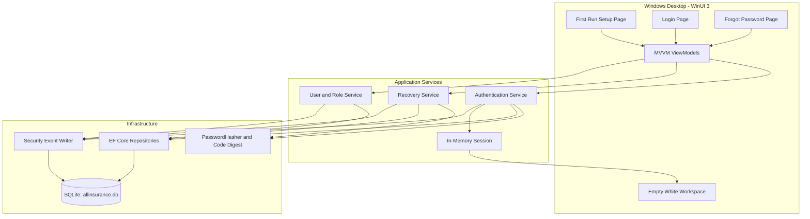
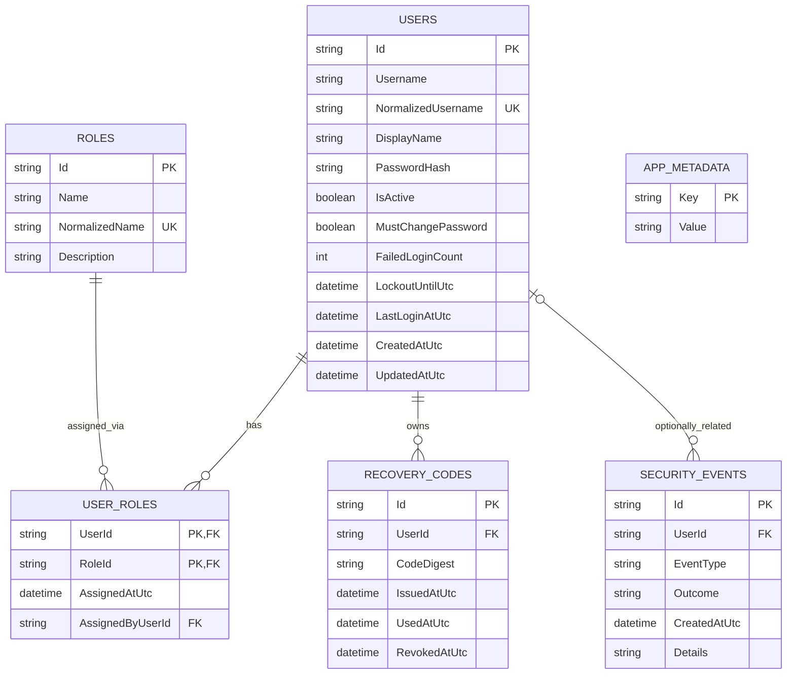
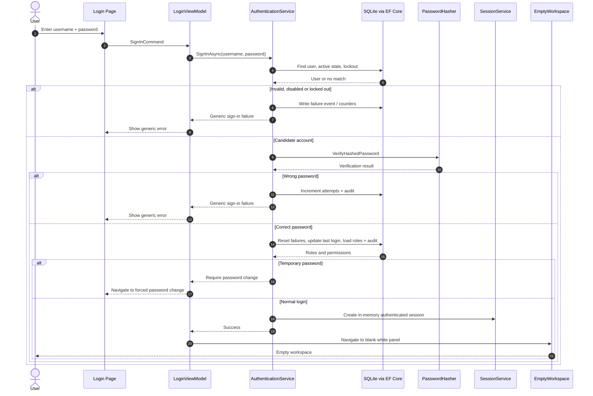
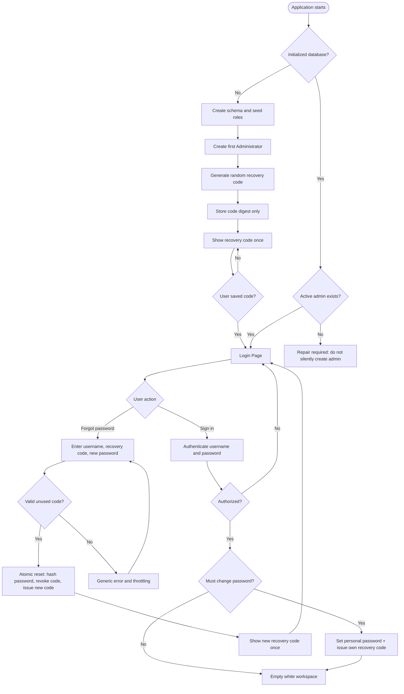
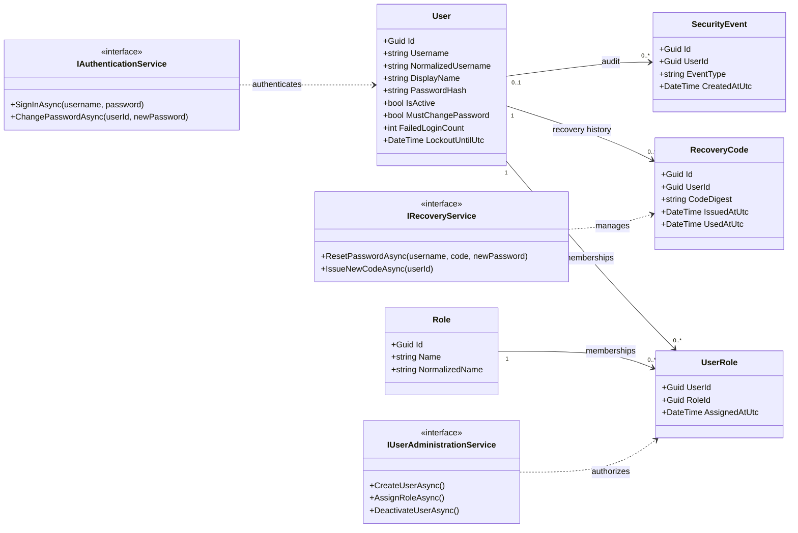

# All Insurance — Phase 01: Core Foundation & Authentication

**Complete GitHub-ready software analysis. Updated: 2026-11-03.**

**Online editor for diagrams:** https://mermaid.live/ — copy the Mermaid source between the fenced code markers.

---

# 01 — Scope and Functional Requirements

## Product identity

- Application: **All Insurance Back Office**
- Phase: **01 — Core Foundation & Authentication**
- Platform: Windows desktop, offline-first
- Local storage: SQLite
- Language: English for internal code and this specification; UI localization-ready, with Greek resources easy to add later

## In scope

- Start and initialize the application, dependency injection container, configuration, database and migrations.
- Create the initial local SQLite database if missing; initialize its schema transactionally, with deterministic role seeds.
- Detect first installation and require creation of the first `Administrator` account; no preconfigured admin/password.
- Support multiple distinct application users, even if initially one admin is created.
- Support multiple roles per user via a join table; initially `Administrator` and `Employee`.
- Provide application services for creating/deactivating users, assigning roles and resetting employee credentials, with admin authorization. **No management screens yet.** These service operations will be testable without UI.
- Offer login screen with username and password, field validation, errors and failed-attempt throttling.
- Require temporary-password replacement on first employee sign-in.
- Issue **one individual offline recovery code per user** on setup/first successful account activation; display it once, require acknowledgment, never log the plaintext.
- Offer `Forgot password?` flow: username + recovery code + new password + confirmation. Successfully used code is immediately revoked and replaced with a newly issued code shown once.
- Keep auditable security events (successful login, rejected login, lockout, recovery, user/role changes) without secrets.
- Start an in-memory authenticated session; fetch permissions from the application services; block navigation unless authenticated.
- On successful login, display **only a plain white panel**. Closing the app ends the session.

## Out of scope (Phase 01 only)

- Insurance policies, clients, quotes, accounting, production files, insurer connections, CRM.
- User-management UI, dashboard, navigation/sidebar, reports or settings pages.
- Email/SMS recovery, remote account federation, cloud sync, web API, multi-device shared data.
- Offline activation/licensing, automatic updates, installer artwork, commercial deployment.

## User roles and permissions

| Capability | Administrator | Employee |
|---|:---:|:---:|
| Sign in | Yes | Yes |
| Change own password / own recovery code | Yes | Yes |
| Open blank post-login workspace | Yes | Yes |
| Create / deactivate users (service only) | Yes | No |
| Assign/revoke roles (service only) | Yes | No |
| Reset an employee's password (service only) | Yes | No |
| Read security-audit events (service only) | Yes | No |

**Rules:** Permissions are checked in the application/service layer, not only by hiding buttons. Protect the last active administrator from deactivation or loss of the Administrator role. New roles can be added without changing the schema.

## First-run configuration

1. On startup, inspect whether database is initialized and at least one active administrator exists.
2. For a new installation, create schema + seed roles; show `Create administrator` screen.
3. Admin enters username, display name, password and confirmation.
4. Create admin using secure password hashing. Generate one 160-bit-or-higher random recovery code.
5. Store only the recovery-code digest and metadata; show recovery code **once** with `Copy` and `I have saved my recovery code` acknowledgment.
6. Continue to login; regular launches skip setup.
7. If setup was interrupted before any account was created, return to first-run setup. If an initialized database later loses its admin, **do not silently provision another**; show a recovery/repair-required state and audit it.

## Quality and non-functional requirements

- UI remains responsive; database work does not block the UI thread.
- Keyboard navigation, visible focus, readable contrast, screen-reader labels and responsive sizing.
- All user-facing errors are actionable but reveal no credential validity.
- Use UTC timestamps in persistence and local time only for display.
- Migrations/versioning instead of `EnsureCreated` for a database that will evolve.
- Automated unit/integration tests for authentication, role checks and SQLite persistence.
- Never commit generated databases, secrets or real user data to GitHub.

---

# 02 — Technical Architecture and GitHub Source Layout

## Validated stack (2026-11-03)

| Layer | Selection | Rationale |
|---|---|---|
| Runtime | .NET 10 LTS | Stable, long-term supported, suitable for commercial Windows app |
| Native UI | WinUI 3 (Windows App SDK 2.6.4 stable as documented) | Microsoft's recommended new Windows desktop UI and Fluent controls |
| UI pattern | MVVM via `CommunityToolkit.Mvvm` | Testable state and commands, minimal code-behind |
| Dependency injection | `Microsoft.Extensions.DependencyInjection` | Consistent composition root and testable interfaces |
| Database | SQLite + `Microsoft.EntityFrameworkCore.Sqlite` 10.x | Embedded, no separate DB server needed on one PC |
| Password hashing | `Microsoft.AspNetCore.Identity.PasswordHasher<TUser>` | Battle-tested, versioned password hashes; not reversible encryption |
| Application logs | `Microsoft.Extensions.Logging`, optional supported file sink | Diagnostics without sensitive values |
| Local secrets | Windows DPAPI where reversible encryption is truly needed | OS-bound protection for local secrets; not a password hash replacement |
| Distribution | MSIX preferred evaluation target | Modern Windows packaging; choose a supported installer/deployment mode later |

**Version discipline:** Use the latest **stable compatible patch** at project creation, check WinUI 3/.NET compatibility, pin packages centrally and audit updates before deployment. Avoid preview/experimental SDK dependencies for the production baseline.

## Logical architecture

- `AllInsurance.Desktop`: WinUI pages/windows, styles, resource dictionaries, view models, app bootstrap and navigation.
- `AllInsurance.Application`: use cases, security policy, services, interfaces, application DTOs and authorization handlers.
- `AllInsurance.Domain`: business-independent user/role/recovery/audit entities and invariant rules.
- `AllInsurance.Infrastructure`: EF Core SQLite DbContext, mappings, migrations, repository implementations, clock/crypto adapters.
- `AllInsurance.Tests`: unit tests and SQLite integration tests.

**Dependency direction:** Desktop -> Application -> Domain. Infrastructure depends on Application and Domain; Desktop registers concrete infrastructure implementations. Domain must not reference WinUI or EF Core.

### Suggested source repository structure (distinct from Software Analysis)

```text
AllInsurance.sln
src/
  AllInsurance.Desktop/
    App.xaml
    App.xaml.cs
    Views/
      SetupAdminPage.xaml
      RecoveryKeyPage.xaml
      LoginPage.xaml
      ForgotPasswordPage.xaml
      EmptyWorkspacePage.xaml
    ViewModels/
    Resources/Styles/
    Services/NavigationService.cs
  AllInsurance.Application/
    Abstractions/
    Authentication/
    Users/
    Authorization/
  AllInsurance.Domain/
    Entities/
    Enums/
  AllInsurance.Infrastructure/
    Persistence/
      AllInsuranceDbContext.cs
      Configurations/
      Migrations/
    Security/
    Repositories/
tests/
  AllInsurance.Tests/
Software Analysis/
  01 - Core Foundation & Authentication/
```

## Startup lifecycle

1. Initialize host/services and protected configuration.
2. Resolve SQLite path (`%ProgramData%\\AllInsurance\\Data\\allinsurance.db` for a shared on-machine installation; Windows directory ACLs are mandatory).
3. Create a backup before **future** non-initial schema migrations; apply EF Core migrations under controlled one-instance startup.
4. If new database, create required roles and offer initial administrator setup.
5. Else show Login. Once authenticated, navigate to an empty white workspace.
6. Dispose session on application close; do not persist passwords or recovery codes.

## Data location, backups, multiuser limits

- For a same-PC installation, use `%ProgramData%` with carefully provisioned ACLs, or `%LOCALAPPDATA%` for strictly per-OS-user installs. Don't mix these patterns accidentally.
- Enable SQLite foreign keys; set busy timeout; consider WAL mode for local concurrency if justified by tests. WAL files are part of an active database and require proper backup handling.
- Back up using SQLite's supported backup approach or database-aware snapshot strategy, not naïve copying of just a live `.db` while active.
- **Do not expose writable SQLite directly to multiple Windows PCs over a shared folder.** SQLite recommends an application server/client-server DB for that scenario.
- **Important security boundary:** If employees can edit the SQLite file at OS level, they can bypass UI permissions. For production enforcement against untrusted employees, place database access behind a protected Windows service or server/API with OS-controlled file access. This phase models authorization but does not guarantee tamper resistance against local filesystem attackers.

---

# 03 — Starter SQLite Data Model

## Entities and attributes

### `Users`

| Column | Type | Notes |
|---|---|---|
| `Id` | TEXT (UUID) | Primary key |
| `Username` | TEXT | Required, display/original case |
| `NormalizedUsername` | TEXT | Required, UNIQUE, invariant normalized format |
| `DisplayName` | TEXT | Required |
| `PasswordHash` | TEXT | Required; Microsoft PasswordHasher format, never plaintext |
| `IsActive` | INTEGER (BOOL) | Default 1 |
| `MustChangePassword` | INTEGER (BOOL) | For admin-provisioned temporary credentials |
| `FailedLoginCount` | INTEGER | Default 0 |
| `LockoutUntilUtc` | TEXT (UTC datetime, nullable) | Authentication throttling |
| `LastLoginAtUtc` | TEXT (UTC datetime, nullable) | Last successful login |
| `CreatedAtUtc` | TEXT (UTC datetime) | Required |
| `UpdatedAtUtc` | TEXT (UTC datetime) | Required |

### `Roles`

| Column | Type | Notes |
|---|---|---|
| `Id` | TEXT (UUID) | Primary key; seeded deterministically |
| `Name` | TEXT | Required |
| `NormalizedName` | TEXT | Required, UNIQUE |
| `Description` | TEXT | Optional |

Initial seed records: `Administrator`, `Employee` (no default user/password).

### `UserRoles`

| Column | Type | Notes |
|---|---|---|
| `UserId` | TEXT (UUID) | FK -> Users.Id |
| `RoleId` | TEXT (UUID) | FK -> Roles.Id |
| `AssignedAtUtc` | TEXT (UTC datetime) | Required |
| `AssignedByUserId` | TEXT (UUID, nullable) | Optional FK -> Users.Id |

Composite PRIMARY KEY (`UserId`, `RoleId`). User can have **many** roles and a role can belong to **many** users. Restrict deletion of roles in use.

### `RecoveryCodes`

| Column | Type | Notes |
|---|---|---|
| `Id` | TEXT (UUID) | Primary key |
| `UserId` | TEXT (UUID) | FK -> Users.Id |
| `CodeDigest` | TEXT | SHA-256 digest of a **cryptographically random 160-bit or stronger code**, never the code |
| `IssuedAtUtc` | TEXT (UTC datetime) | Required |
| `UsedAtUtc` | TEXT (UTC datetime, nullable) | Used/revoked marker |
| `RevokedAtUtc` | TEXT (UTC datetime, nullable) | Explicit revocation |

Only one **active** recovery code is permitted per user; enforce with a SQLite partial unique index (`WHERE UsedAtUtc IS NULL AND RevokedAtUtc IS NULL`) or equivalent controlled transaction. Treat the 160-bit code as a high-entropy token; use constant-time digest comparison. Do **not** use SHA-256 alone for a human-chosen password.

### `SecurityEvents`

| Column | Type | Notes |
|---|---|---|
| `Id` | TEXT (UUID) | Primary key |
| `UserId` | TEXT (UUID, nullable) | Nullable if unknown username attempted |
| `EventType` | TEXT | LOGIN_SUCCESS / LOGIN_FAILURE / ACCOUNT_LOCKED / PASSWORD_RESET / USER_CHANGED / ROLE_CHANGED etc. |
| `Outcome` | TEXT | SUCCESS / FAILURE |
| `CreatedAtUtc` | TEXT (UTC datetime) | Required |
| `Details` | TEXT (nullable) | Nonsecret structured reason or context, no passwords/codes |

### `AppMetadata`

| Column | Type | Notes |
|---|---|---|
| `Key` | TEXT | Primary key |
| `Value` | TEXT | Required |

Example: `schema_version` / `installation_id` (nonsecret). EF Core also creates its internal migration-history table.

## Data rules and integrity

- Unique indexes: `Users.NormalizedUsername`, `Roles.NormalizedName`; foreign keys for membership/recovery/audit.
- Data access through repositories and EF Core queries, parameterized by design.
- UTC everywhere in persistence; make flags and role membership explicit.
- Don't silently recreate a missing admin on an **existing** database.
- Create schema from EF Core migrations; migrations are source-controlled and reversible/tested where possible.
- Seed roles idempotently; do not seed any real account or recovery code.
- Restrict and audit changes to administrator roles; never allow removal of the last active administrator.
- No insurance/customer personal data is stored in Phase 01.

---

# 04 — Authentication, Initial Setup and Offline Recovery

## 1. Sign in

1. Normalize submitted username (consistent invariant rule); find active user if one exists.
2. Check applicable persistent lockout policy and throttle. Recommended starting policy: 5 rejected attempts -> 15-minute lockout; make configurable and test it.
3. Verify password against `PasswordHash` using Microsoft's `PasswordHasher<TUser>` or another vetted password-hashing API. **Never decrypt passwords**, and never use reversible storage for them.
4. Invalid username and invalid password must display the **same** generic error. Record failed attempts without logging credentials.
5. On success, reset failure counter and lockout, update `LastLoginAtUtc`, load roles and permissions.
6. If `MustChangePassword`, require password change, then issue individual recovery code if not yet issued.
7. Establish **in-memory session**; navigate to blank workspace. No unprotected deep navigation or bypass.
8. At close, discard in-memory session.

## 2. First launch / initial administrator

- New database -> migrate -> seed `Administrator`/`Employee` -> show first-run setup.
- Require username, display name and a strong password (support long passphrases, reject obvious/common passwords if a trustworthy check is available).
- Persist admin user and role assignment in a transaction.
- Generate **at least 160 random bits** using the operating system cryptographic RNG. Encode in grouped Base32/Crockford-style characters for human entry (example pattern only, **not a real key**: `XXXX-XXXX-XXXX-XXXX-XXXX-XXXX-XXXX-XXXX`).
- Show generated recovery code **once**; require user to confirm they stored it. Avoid screenshots, logs, telemetry and ordinary plaintext files as persistence.
- Persist only its one-way digest and issue metadata; then show login screen.
- The first-run recovery code is an authentication recovery **secret**, not a database encryption key.

## 3. `Forgot Password?` offline recovery flow

1. User selects `Forgot password?` and enters **username + individual recovery code** and a new password twice.
2. Check active account, recovery-attempt throttling and code digest using constant-time comparison. Return a generic error for invalid account/code.
3. On valid code, change password hash, clear lockout, mark old code used and issue a **new code** in **one database transaction**.
4. Show replacement code once, with acknowledgment. User returns to Login and signs in with the new password.
5. Recovery attempts and outcomes are security events, but never contain a password or recovery code.
6. If employee loses their code, an authenticated Administrator can reset that account via secured service and issue a temporary password. The employee must change it and receive a fresh recovery code on next sign-in.
7. If the **sole administrator** loses both password and recovery code, do not implement a magic master password/backdoor. Require a documented identity-verified administrative recovery or restore from a properly protected backup.

## 4. Local security, backups and secret scope

- **Password**: store a salted, adaptive **hash**; Microsoft `PasswordHasher<TUser>` is appropriate for a desktop app even without an ASP.NET web frontend.
- **Recovery code**: use CSPRNG; store only digest of high-entropy code; revoke on use; rate-limit attempts.
- **SQLite file**: SQLite is not encrypted by default. Use OS ACL + BitLocker where available; consider database-level encryption (such as SQLCipher with a well-designed key/backup strategy) before storing sensitive insurance or customer records.
- **DPAPI**: suitable for protecting actual local secrets that must later be decrypted, if any. It is **not** the storage method for user passwords or recovery codes.
- **Windows privilege boundary**: a user with direct write access to the SQLite file can tamper with accounts; application roles only control application pathways. For production roles against untrusted local users, a secured broker service/server must own SQLite access.
- **Audit logs**: never include passwords, recovery codes, token digests, full SQL connection strings or unrelated insurance/customer personal details.

---

# 05 — UI, UX and Navigation Specification

## Design direction

Use Windows 11-inspired **Fluent Design** with native WinUI 3 XAML controls, consistent typography, clean whitespace, subtle elevation and restrained brand color. Avoid web-rendered fake desktop windows, unnecessary animations, dense gradients and overcrowded login layouts.

- App title: **All Insurance**
- Suggested accent color: `#1769AA` (placeholder until official brand palette is supplied)
- UI font: Segoe UI Variable / system defaults where supported
- Window: resizable with meaningful minimum dimensions and DPI scaling
- Accessibility: keyboard-first focus order, visible focus, labels, screen-reader support, sufficient contrast
- Include a light/dark-aware login visual design; **post-login workspace is explicitly solid white regardless of theme** for this phase.

## Screen 1: First-Run Administrator Setup

- Header: `Set up All Insurance`
- Fields: Username, Full name, Password, Confirm password
- Password requirements displayed concisely; toggle show/hide password
- Submit: `Create administrator`
- State: validation, password mismatch, duplicate username, loading, recoverable database error
- Upon success: recovery code issuance view, **not** an immediate silent redirect.

## Screen 2: Recovery Code Issuance

- Header: `Your recovery code`
- Prominent, copyable, grouped code; warning `This code is shown only once. Store it securely.`
- Controls: Copy code, `I have stored this code` checkbox, Continue
- Continue disabled until acknowledgment; no recovery code shown again later.

## Screen 3: Login

- Minimal centered or balanced split-layout on a neutral background
- Small All Insurance brand mark/text, headline `Welcome back`, `Sign in to All Insurance`
- Username field, password field with reveal control
- `Sign in` primary button, `Forgot password?` link
- Inline generic error message, caps-lock hint if practical, loading spinner; keyboard Enter submits
- No Sign up, no user role dropdown, no online login, no default credentials advertised.

## Screen 4: Forgot Password

- Header: `Reset your password`
- Fields: Username, Recovery code, New password, Confirm new password
- Controls: `Reset password`, `Back to sign in`
- Generic invalid-code feedback, clear success state and one-time display of rotated replacement recovery code.

## Screen 5: Forced Password Change

- Only displayed for `MustChangePassword` accounts (for example, a newly created employee with a temporary password).
- Fields: New password, Confirm password (current temporary password was already verified during login)
- After change, issue and acknowledge individual recovery code; continue to white workspace.

## Screen 6: Empty Workspace — success destination

- Full application content area is **pure white (`#FFFFFF`)**.
- No sidebar, top navigation, dashboard, cards, placeholder headings or quick actions.
- No customer, policies, CRM or insurance data.
- Internal authenticated session stays valid until application closes. For this exact MVP no visible Sign Out control; support termination by closing the window.

## Navigation contract

`Startup -> (FirstRunSetup -> RecoveryCodeIssued -> Login | Login)`  
`Login -> ForgotPassword -> ReplacementCodeIssued -> Login`  
`Login -> (ForcedPasswordChange -> RecoveryCodeIssued -> EmptyWorkspace | EmptyWorkspace)`

Back navigation must not reveal a one-time recovery code after it has been dismissed. The empty workspace is inaccessible without an authenticated session.

---

# 07 — Acceptance Criteria and Test Plan

## Acceptance checklist

- [x] The project builds as a native WinUI 3 Windows desktop application on the pinned .NET 10 LTS stack.
- [x] A clean installation creates SQLite through EF Core migrations and seeds `Administrator` and `Employee` roles exactly once.
- [x] No hardcoded administrator, recovery code or default password exists.
- [x] First run requires admin creation; normal later launches open login.
- [x] Passwords are stored only as adaptive password hashes and are never written to logs.
- [x] New admin receives a cryptographically random, unique recovery code shown once; database stores no plaintext.
- [x] Database supports two or more separate users, each with one or more assigned roles.
- [x] Application-level authorization prevents employee user-management actions; last active admin is protected.
- [x] Valid login navigates to a **pure-white, blank panel** with no other visual controls.
- [x] Invalid username and invalid password return the same generic user-facing error.
- [x] Login throttle/lockout persists correctly across application restarts.
- [x] Disabled users cannot authenticate.
- [x] Temporary-password employee accounts must change password before blank workspace opens.
- [x] Recovery with an invalid/reused code is rejected and logged without leaking secrets.
- [x] Successful recovery atomically updates password and invalidates the old recovery code; a new code is shown once.
- [x] All security-relevant events are audited with UTC timestamp and no credentials/secrets.
- [x] Database schema/index constraints and foreign keys pass SQLite integration tests.
- [x] Closing app clears in-memory login state; restarting requires login.
- [x] Source repo `.gitignore` excludes local `.db`, `.db-wal`, `.db-shm`, backups, secrets and user-specific config.
- [x] CI executes unit tests and SQLite integration tests; sample fixtures contain no customer data.

**Local validation:** The full solution builds with .NET 10, and all 15 tests pass. The Windows CI workflow is configured in `.github/workflows/ci.yml`.

## Scenarios to execute

1. Fresh DB -> create first admin -> recovery code -> login -> blank white workspace.
2. Restart -> existing login appears; first-run screen never returns.
3. Admin creates employee via application service/test harness -> first login temporary password -> password change -> recovery issuance -> blank workspace.
4. Employee with both `Employee` and another future role gets union of authorized permissions; cannot elevate their own roles.
5. Invalid credentials 5 times -> lockout; retry after configured timeout succeeds with correct password.
6. Valid recovery code -> password reset -> rotated code; attempt to reuse old code fails.
7. Last active administrator cannot be removed or demoted; DB is not left without an admin.
8. Interrupted first run with zero users -> setup resumes. An initialized DB unexpectedly lacking an admin -> explicit failure/recovery state; no silent unsafe admin creation.
9. New app instance while schema migration is in progress -> controlled startup, no duplicate seed or corruption.

## Definition of done

Phase 01 is complete when all acceptance checks pass, diagram documents match the implementation, and **the only visible destination after a successful login is the empty white panel**.

---

# 07 — UML / ER / Process Diagrams

## 01 - System Architecture



## 02 - SQLite Database ERD



## 03 - Login Sequence UML



## 04 - First Run and Recovery Flows



## 05 - Core Class Diagram UML



## References

- [.NET support policy](https://dotnet.microsoft.com/en-us/platform/support/policy/dotnet-core)
- [WinUI 3 recommendation](https://learn.microsoft.com/en-us/windows/apps/winui/)
- [Windows App SDK downloads](https://learn.microsoft.com/en-us/windows/apps/windows-app-sdk/downloads)
- [EF Core SQLite provider](https://learn.microsoft.com/en-us/ef/core/providers/sqlite/)
- [EF Core SQLite limitations](https://learn.microsoft.com/en-us/ef/core/providers/sqlite/limitations)
- [CommunityToolkit.Mvvm](https://learn.microsoft.com/en-us/dotnet/communitytoolkit/mvvm/)
- [Microsoft password hashing](https://learn.microsoft.com/en-us/dotnet/api/microsoft.aspnetcore.identity.passwordhasher-1)
- [SQLite network guidance](https://www.sqlite.org/whentouse.html)
- [Windows DPAPI](https://learn.microsoft.com/en-us/windows/win32/api/dpapi/nf-dpapi-cryptprotectdata)
