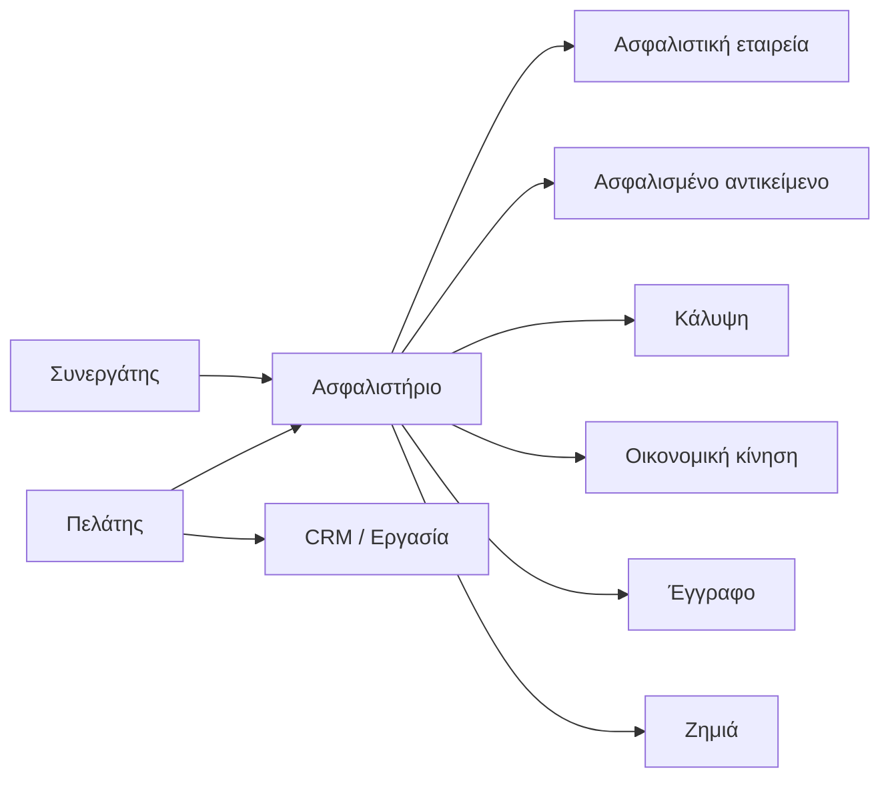
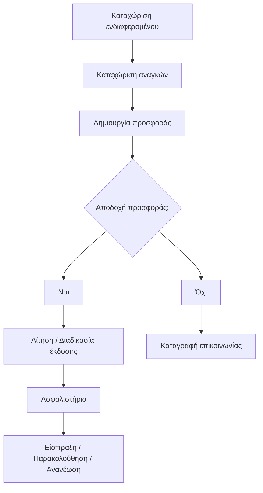

# ALLEN ASSURANCE — Καταγραφή αναγκών Back Office

**Μορφή:** Markdown (`.md`) · **Σκοπός:** Συμπληρώνεται από κοινού σε συνάντηση · **Κατάσταση:** Μη εγκεκριμένο πρότυπο

> **Σημαντικό:** Όλες οι γραμμές πεδίων παραμένουν κενές. Οι επικεφαλίδες και οι ερωτήσεις λειτουργούν μόνο ως οδηγός συνέντευξης· δεν αποτελούν εγκεκριμένες απαιτήσεις, οριστικοποιημένα πεδία ή τεχνική προσφορά.

## 0. Στοιχεία συνάντησης

| Πληροφορία | Συμπλήρωση |
|---|---|
| Ημερομηνία | _________________________________ |
| Τόπος / τρόπος συνάντησης | _________________________________ |
| Εκπρόσωπος Allen Assurance | _________________________________ |
| Εκπρόσωπος Αναδόχου | _________________________________ |
| Τρέχουσα έκδοση καταγραφής | _________________________________ |
| Βασικός στόχος έργου | _________________________________ |
| Πλήθος χρηστών / γραφείων | _________________________________ |
| Ημερομηνία επιβεβαίωσης απαιτήσεων | _________________________________ |

### Οδηγίες

1. Συμπλήρωσε ένα **πεδίο δεδομένων ανά γραμμή**. Αν χρειαστεί, αντέγραψε κενές γραμμές.
2. Επίλεξε προτεραιότητα μόνο αφού συμφωνηθεί: **Απαραίτητο / Επιθυμητό / Μελλοντικό / Εκτός scope**.
3. Κατάγραψε ρόλους, δικαιώματα, φίλτρα, κουμπιά, εισαγωγές και επιχειρησιακούς κανόνες χωριστά.
4. Οι σχέσεις οντοτήτων στο τέλος είναι **ενδεικτικές για συζήτηση**, όχι οριστικό σχήμα βάσης δεδομένων.
5. Δεν καταχωρίζουμε πραγματικά προσωπικά δεδομένα πελατών στο πρότυπο.

### Πρώτες αποφάσεις

- **Εφαρμογή: Web / Windows / υβριδική:** ________________________________________
- **Θα λειτουργεί μέσω browser;:** ________________________________________
- **Desktop app — απαιτήσεις Windows / ενημερώσεων:** ________________________________________
- **Υποστήριξη πολλαπλών γραφείων:** ________________________________________
- **Offline λειτουργία:** ________________________________________
- **Mobile / Tablet πρόσβαση:** ________________________________________
- **Τοποθεσία φιλοξενίας και λήψη αντιγράφων:** ________________________________________
- **Κρίσιμες διασυνδέσεις από την πρώτη έκδοση:** ________________________________________

## 0.1. Χάρτης ενοτήτων και οθονών

| Ενότητα | Απαιτείται; | Αρμόδιος έγκρισης | Παρατηρήσεις |
|---|---|---|---|
| 01 | Επιχείρηση και επιχειρησιακοί στόχοι | ☐ Ναι ☐ Όχι ☐ Εκκρεμεί | __________ | __________ |
| 02 | Εταιρική ταυτότητα και χρωματική παλέτα | ☐ Ναι ☐ Όχι ☐ Εκκρεμεί | __________ | __________ |
| 03 | Πλατφόρμα και Desktop εφαρμογή | ☐ Ναι ☐ Όχι ☐ Εκκρεμεί | __________ | __________ |
| 04Α | Navbar και sidebar | ☐ Ναι ☐ Όχι ☐ Εκκρεμεί | __________ | __________ |
| 04Β | Οθόνες, φίλτρα και λίστες | ☐ Ναι ☐ Όχι ☐ Εκκρεμεί | __________ | __________ |
| 05 | Χρήστες, ρόλοι και δικαιώματα | ☐ Ναι ☐ Όχι ☐ Εκκρεμεί | __________ | __________ |
| 06Α | Καρτέλα πελάτη · Φυσικό πρόσωπο | ☐ Ναι ☐ Όχι ☐ Εκκρεμεί | __________ | __________ |
| 06Β | Καρτέλα πελάτη · Επικοινωνία | ☐ Ναι ☐ Όχι ☐ Εκκρεμεί | __________ | __________ |
| 06Γ | Καρτέλα πελάτη · Εταιρεία/νομικό πρόσωπο | ☐ Ναι ☐ Όχι ☐ Εκκρεμεί | __________ | __________ |
| 06Δ | Καρτέλα πελάτη · Ιστορικό και σχέσεις | ☐ Ναι ☐ Όχι ☐ Εκκρεμεί | __________ | __________ |
| 07Α | Καρτέλα συνεργάτη · Ταυτότητα | ☐ Ναι ☐ Όχι ☐ Εκκρεμεί | __________ | __________ |
| 07Β | Καρτέλα συνεργάτη · Οικονομικά | ☐ Ναι ☐ Όχι ☐ Εκκρεμεί | __________ | __________ |
| 07Γ | Ασφαλιστικές εταιρείες | ☐ Ναι ☐ Όχι ☐ Εκκρεμεί | __________ | __________ |
| 08Α | Ασφαλιστήριο · Βασική καρτέλα | ☐ Ναι ☐ Όχι ☐ Εκκρεμεί | __________ | __________ |
| 08Β | Ασφαλιστήριο · Καλύψεις | ☐ Ναι ☐ Όχι ☐ Εκκρεμεί | __________ | __________ |
| 08Γ | Ασφαλιστήριο · Οικονομικά | ☐ Ναι ☐ Όχι ☐ Εκκρεμεί | __________ | __________ |
| 09Α | Ασφαλισμένα αντικείμενα · Οχήματα | ☐ Ναι ☐ Όχι ☐ Εκκρεμεί | __________ | __________ |
| 09Β | Ασφαλισμένα αντικείμενα · Ακίνητα | ☐ Ναι ☐ Όχι ☐ Εκκρεμεί | __________ | __________ |
| 09Γ | Ασφαλισμένα αντικείμενα · Σκάφη και λοιπά | ☐ Ναι ☐ Όχι ☐ Εκκρεμεί | __________ | __________ |
| 10 | Προσφορές, αιτήσεις και έκδοση | ☐ Ναι ☐ Όχι ☐ Εκκρεμεί | __________ | __________ |
| 11Α | Ταμείο και εισπράξεις | ☐ Ναι ☐ Όχι ☐ Εκκρεμεί | __________ | __________ |
| 11Β | Παραγωγή και εκκαθαρίσεις | ☐ Ναι ☐ Όχι ☐ Εκκρεμεί | __________ | __________ |
| 12Α | Ανανεώσεις, μεταβολές, ακυρώσεις | ☐ Ναι ☐ Όχι ☐ Εκκρεμεί | __________ | __________ |
| 12Β | Ζημιές και claims | ☐ Ναι ☐ Όχι ☐ Εκκρεμεί | __________ | __________ |
| 13Α | CRM και επαφές | ☐ Ναι ☐ Όχι ☐ Εκκρεμεί | __________ | __________ |
| 13Β | Εργασίες και ραντεβού | ☐ Ναι ☐ Όχι ☐ Εκκρεμεί | __________ | __________ |
| 13Γ | Πύλη Πελάτη | ☐ Ναι ☐ Όχι ☐ Εκκρεμεί | __________ | __________ |
| 13Δ | Πύλη Συνεργάτη | ☐ Ναι ☐ Όχι ☐ Εκκρεμεί | __________ | __________ |
| 14 | Dashboards, αναφορές και KPIs | ☐ Ναι ☐ Όχι ☐ Εκκρεμεί | __________ | __________ |
| 15 | Έγγραφα, πρότυπα και υπογραφές | ☐ Ναι ☐ Όχι ☐ Εκκρεμεί | __________ | __________ |
| 16 | Imports, APIs, αυτοματισμοί και logs | ☐ Ναι ☐ Όχι ☐ Εκκρεμεί | __________ | __________ |
| 17 | GDPR, ασφάλεια και συμμόρφωση | ☐ Ναι ☐ Όχι ☐ Εκκρεμεί | __________ | __________ |
| 18 | Migration, εκπαίδευση και υποστήριξη | ☐ Ναι ☐ Όχι ☐ Εκκρεμεί | __________ | __________ |
| 19 | Επιχειρησιακές ροές / σενάρια UAT | ☐ Ναι ☐ Όχι ☐ Εκκρεμεί | __________ | __________ |
| 20 | Φάσεις, προτεραιότητες, αποφάσεις | ☐ Ναι ☐ Όχι ☐ Εκκρεμεί | __________ | __________ |

---

## 01 | Επιχείρηση και επιχειρησιακοί στόχοι

*Οδηγός συζήτησης:* Γραφεία, δραστηριότητες, χρήστες, ανάγκες και στόχοι.

| Γενικά | Συμπλήρωση |
|---|---|
| Κωδικός οντότητας / οθόνης | _________________________ |
| Θέση στο navbar / sidebar | _________________________ |
| Υποκαρτέλα / ομάδα πεδίων | _________________________ |
| Ποιος ρόλος χρησιμοποιεί την οθόνη | _________________________ |
| Σκοπός της οθόνης | _________________________ |
| Προτεραιότητα | _________________________ |
| Αρμόδιος έγκρισης | _________________________ |

### Α. Κενά πεδία δεδομένων

| # | Όνομα πεδίου | Τύπος / επιλογές | Υποχρ.; | Σημειώσεις / κανόνας |
|---:|---|---|:---:|---|
| 1 | __________ | __________ | ☐ | __________ |
| 2 | __________ | __________ | ☐ | __________ |
| 3 | __________ | __________ | ☐ | __________ |
| 4 | __________ | __________ | ☐ | __________ |
| 5 | __________ | __________ | ☐ | __________ |
| 6 | __________ | __________ | ☐ | __________ |
| 7 | __________ | __________ | ☐ | __________ |
| 8 | __________ | __________ | ☐ | __________ |
| 9 | __________ | __________ | ☐ | __________ |
| 10 | __________ | __________ | ☐ | __________ |

### Β. Κενές ενέργειες, κουμπιά και φίλτρα

| # | Όνομα / ενέργεια | Ποιοι ρόλοι | Τι κάνει / κανόνας |
|---:|---|---|---|
| 1 | __________ | __________ | __________ |
| 2 | __________ | __________ | __________ |
| 3 | __________ | __________ | __________ |
| 4 | __________ | __________ | __________ |

### Γ. Συσχετίσεις με άλλες οντότητες

| Από οντότητα | Προς οντότητα | Σχέση / πλήθος | Περιγραφή |
|---|---|---|---|
| __________ | __________ | __________ | __________ |
| __________ | __________ | __________ | __________ |

### Δ. Ανοικτά ερωτήματα

- **Ποια δραστηριότητα ή δυσκολία θέλουμε να καλύψουμε;**  
  Απάντηση: __________________________________________
- **Ποιο αποτέλεσμα θα θεωρηθεί επιτυχία;**  
  Απάντηση: __________________________________________

### Ε. Επιχειρησιακοί κανόνες και εξαιρέσεις

- **Κανόνας 1:** __________________________________________
- **Κανόνας 2:** __________________________________________
- **Κανόνας 3:** __________________________________________

**Στάδιο:** ☐ Προς συζήτηση ☐ Επιβεβαιωμένο ☐ Σε εκκρεμότητα ☐ Εκτός πρώτης έκδοσης  
**Εγκρίθηκε από:** _____________________ **Ημερομηνία:** ____ / ____ / ______

---

## 02 | Εταιρική ταυτότητα και χρωματική παλέτα

*Οδηγός συζήτησης:* Λογότυπο, primary/secondary χρώματα, γραμματοσειρές, UI/UX.

| Γενικά | Συμπλήρωση |
|---|---|
| Κωδικός οντότητας / οθόνης | _________________________ |
| Θέση στο navbar / sidebar | _________________________ |
| Υποκαρτέλα / ομάδα πεδίων | _________________________ |
| Ποιος ρόλος χρησιμοποιεί την οθόνη | _________________________ |
| Σκοπός της οθόνης | _________________________ |
| Προτεραιότητα | _________________________ |
| Αρμόδιος έγκρισης | _________________________ |

### Α. Κενά πεδία δεδομένων

| # | Όνομα πεδίου | Τύπος / επιλογές | Υποχρ.; | Σημειώσεις / κανόνας |
|---:|---|---|:---:|---|
| 1 | __________ | __________ | ☐ | __________ |
| 2 | __________ | __________ | ☐ | __________ |
| 3 | __________ | __________ | ☐ | __________ |
| 4 | __________ | __________ | ☐ | __________ |
| 5 | __________ | __________ | ☐ | __________ |
| 6 | __________ | __________ | ☐ | __________ |
| 7 | __________ | __________ | ☐ | __________ |
| 8 | __________ | __________ | ☐ | __________ |
| 9 | __________ | __________ | ☐ | __________ |
| 10 | __________ | __________ | ☐ | __________ |

### Β. Κενές ενέργειες, κουμπιά και φίλτρα

| # | Όνομα / ενέργεια | Ποιοι ρόλοι | Τι κάνει / κανόνας |
|---:|---|---|---|
| 1 | __________ | __________ | __________ |
| 2 | __________ | __________ | __________ |
| 3 | __________ | __________ | __________ |
| 4 | __________ | __________ | __________ |

### Γ. Συσχετίσεις με άλλες οντότητες

| Από οντότητα | Προς οντότητα | Σχέση / πλήθος | Περιγραφή |
|---|---|---|---|
| __________ | __________ | __________ | __________ |
| __________ | __________ | __________ | __________ |

### Δ. Ανοικτά ερωτήματα

- **Ποιο είναι το εγκεκριμένο εταιρικό λογότυπο και η χρωματική παλέτα;**  
  Απάντηση: __________________________________________
- **Ποιοι είναι οι κανόνες για κείμενα, πίνακες, states και προσβασιμότητα;**  
  Απάντηση: __________________________________________

### Ε. Επιχειρησιακοί κανόνες και εξαιρέσεις

- **Κανόνας 1:** __________________________________________
- **Κανόνας 2:** __________________________________________
- **Κανόνας 3:** __________________________________________

**Στάδιο:** ☐ Προς συζήτηση ☐ Επιβεβαιωμένο ☐ Σε εκκρεμότητα ☐ Εκτός πρώτης έκδοσης  
**Εγκρίθηκε από:** _____________________ **Ημερομηνία:** ____ / ____ / ______

---

## 03 | Πλατφόρμα και Desktop εφαρμογή

*Οδηγός συζήτησης:* Web, Windows, εγκατάσταση, σύνδεση, ενημερώσεις, τεχνική υποδομή.

| Γενικά | Συμπλήρωση |
|---|---|
| Κωδικός οντότητας / οθόνης | _________________________ |
| Θέση στο navbar / sidebar | _________________________ |
| Υποκαρτέλα / ομάδα πεδίων | _________________________ |
| Ποιος ρόλος χρησιμοποιεί την οθόνη | _________________________ |
| Σκοπός της οθόνης | _________________________ |
| Προτεραιότητα | _________________________ |
| Αρμόδιος έγκρισης | _________________________ |

### Α. Κενά πεδία δεδομένων

| # | Όνομα πεδίου | Τύπος / επιλογές | Υποχρ.; | Σημειώσεις / κανόνας |
|---:|---|---|:---:|---|
| 1 | __________ | __________ | ☐ | __________ |
| 2 | __________ | __________ | ☐ | __________ |
| 3 | __________ | __________ | ☐ | __________ |
| 4 | __________ | __________ | ☐ | __________ |
| 5 | __________ | __________ | ☐ | __________ |
| 6 | __________ | __________ | ☐ | __________ |
| 7 | __________ | __________ | ☐ | __________ |
| 8 | __________ | __________ | ☐ | __________ |
| 9 | __________ | __________ | ☐ | __________ |
| 10 | __________ | __________ | ☐ | __________ |

### Β. Κενές ενέργειες, κουμπιά και φίλτρα

| # | Όνομα / ενέργεια | Ποιοι ρόλοι | Τι κάνει / κανόνας |
|---:|---|---|---|
| 1 | __________ | __________ | __________ |
| 2 | __________ | __________ | __________ |
| 3 | __________ | __________ | __________ |
| 4 | __________ | __________ | __________ |

### Γ. Συσχετίσεις με άλλες οντότητες

| Από οντότητα | Προς οντότητα | Σχέση / πλήθος | Περιγραφή |
|---|---|---|---|
| __________ | __________ | __________ | __________ |
| __________ | __________ | __________ | __________ |

### Δ. Ανοικτά ερωτήματα

- **Ποια πλατφόρμα/λειτουργικά συστήματα υποστηρίζονται;**  
  Απάντηση: __________________________________________
- **Χρειάζεται λειτουργία offline ή συγχρονισμός πολλών γραφείων;**  
  Απάντηση: __________________________________________

### Ε. Επιχειρησιακοί κανόνες και εξαιρέσεις

- **Κανόνας 1:** __________________________________________
- **Κανόνας 2:** __________________________________________
- **Κανόνας 3:** __________________________________________

**Στάδιο:** ☐ Προς συζήτηση ☐ Επιβεβαιωμένο ☐ Σε εκκρεμότητα ☐ Εκτός πρώτης έκδοσης  
**Εγκρίθηκε από:** _____________________ **Ημερομηνία:** ____ / ____ / ______

---

## 04Α | Navbar και sidebar

*Οδηγός συζήτησης:* Κεντρική πλοήγηση, αναζήτηση, ειδοποιήσεις, κύριο μενού.

| Γενικά | Συμπλήρωση |
|---|---|
| Κωδικός οντότητας / οθόνης | _________________________ |
| Θέση στο navbar / sidebar | _________________________ |
| Υποκαρτέλα / ομάδα πεδίων | _________________________ |
| Ποιος ρόλος χρησιμοποιεί την οθόνη | _________________________ |
| Σκοπός της οθόνης | _________________________ |
| Προτεραιότητα | _________________________ |
| Αρμόδιος έγκρισης | _________________________ |

### Α. Κενά πεδία δεδομένων

| # | Όνομα πεδίου | Τύπος / επιλογές | Υποχρ.; | Σημειώσεις / κανόνας |
|---:|---|---|:---:|---|
| 1 | __________ | __________ | ☐ | __________ |
| 2 | __________ | __________ | ☐ | __________ |
| 3 | __________ | __________ | ☐ | __________ |
| 4 | __________ | __________ | ☐ | __________ |
| 5 | __________ | __________ | ☐ | __________ |
| 6 | __________ | __________ | ☐ | __________ |
| 7 | __________ | __________ | ☐ | __________ |
| 8 | __________ | __________ | ☐ | __________ |
| 9 | __________ | __________ | ☐ | __________ |
| 10 | __________ | __________ | ☐ | __________ |

### Β. Κενές ενέργειες, κουμπιά και φίλτρα

| # | Όνομα / ενέργεια | Ποιοι ρόλοι | Τι κάνει / κανόνας |
|---:|---|---|---|
| 1 | __________ | __________ | __________ |
| 2 | __________ | __________ | __________ |
| 3 | __________ | __________ | __________ |
| 4 | __________ | __________ | __________ |

### Γ. Συσχετίσεις με άλλες οντότητες

| Από οντότητα | Προς οντότητα | Σχέση / πλήθος | Περιγραφή |
|---|---|---|---|
| __________ | __________ | __________ | __________ |
| __________ | __________ | __________ | __________ |

### Δ. Ανοικτά ερωτήματα

- **Ποια στοιχεία φαίνονται σε κάθε οθόνη του navbar;**  
  Απάντηση: __________________________________________
- **Πώς λειτουργεί η πλοήγηση ανά ρόλο;**  
  Απάντηση: __________________________________________

### Ε. Επιχειρησιακοί κανόνες και εξαιρέσεις

- **Κανόνας 1:** __________________________________________
- **Κανόνας 2:** __________________________________________
- **Κανόνας 3:** __________________________________________

**Στάδιο:** ☐ Προς συζήτηση ☐ Επιβεβαιωμένο ☐ Σε εκκρεμότητα ☐ Εκτός πρώτης έκδοσης  
**Εγκρίθηκε από:** _____________________ **Ημερομηνία:** ____ / ____ / ______

---

## 04Β | Οθόνες, φίλτρα και λίστες

*Οδηγός συζήτησης:* Λίστες, tabs, ενέργειες, στήλες, φίλτρα, exports.

| Γενικά | Συμπλήρωση |
|---|---|
| Κωδικός οντότητας / οθόνης | _________________________ |
| Θέση στο navbar / sidebar | _________________________ |
| Υποκαρτέλα / ομάδα πεδίων | _________________________ |
| Ποιος ρόλος χρησιμοποιεί την οθόνη | _________________________ |
| Σκοπός της οθόνης | _________________________ |
| Προτεραιότητα | _________________________ |
| Αρμόδιος έγκρισης | _________________________ |

### Α. Κενά πεδία δεδομένων

| # | Όνομα πεδίου | Τύπος / επιλογές | Υποχρ.; | Σημειώσεις / κανόνας |
|---:|---|---|:---:|---|
| 1 | __________ | __________ | ☐ | __________ |
| 2 | __________ | __________ | ☐ | __________ |
| 3 | __________ | __________ | ☐ | __________ |
| 4 | __________ | __________ | ☐ | __________ |
| 5 | __________ | __________ | ☐ | __________ |
| 6 | __________ | __________ | ☐ | __________ |
| 7 | __________ | __________ | ☐ | __________ |
| 8 | __________ | __________ | ☐ | __________ |
| 9 | __________ | __________ | ☐ | __________ |
| 10 | __________ | __________ | ☐ | __________ |

### Β. Κενές ενέργειες, κουμπιά και φίλτρα

| # | Όνομα / ενέργεια | Ποιοι ρόλοι | Τι κάνει / κανόνας |
|---:|---|---|---|
| 1 | __________ | __________ | __________ |
| 2 | __________ | __________ | __________ |
| 3 | __________ | __________ | __________ |
| 4 | __________ | __________ | __________ |

### Γ. Συσχετίσεις με άλλες οντότητες

| Από οντότητα | Προς οντότητα | Σχέση / πλήθος | Περιγραφή |
|---|---|---|---|
| __________ | __________ | __________ | __________ |
| __________ | __________ | __________ | __________ |

### Δ. Ανοικτά ερωτήματα

- **Ποια φίλτρα, στήλες και μαζικές ενέργειες χρειάζονται;**  
  Απάντηση: __________________________________________
- **Τι μπορεί να εξάγεται σε αρχείο;**  
  Απάντηση: __________________________________________

### Ε. Επιχειρησιακοί κανόνες και εξαιρέσεις

- **Κανόνας 1:** __________________________________________
- **Κανόνας 2:** __________________________________________
- **Κανόνας 3:** __________________________________________

**Στάδιο:** ☐ Προς συζήτηση ☐ Επιβεβαιωμένο ☐ Σε εκκρεμότητα ☐ Εκτός πρώτης έκδοσης  
**Εγκρίθηκε από:** _____________________ **Ημερομηνία:** ____ / ____ / ______

---

## 05 | Χρήστες, ρόλοι και δικαιώματα

*Οδηγός συζήτησης:* Προσβάσεις, τμήματα, γραφεία, ενέργειες και περιορισμοί.

| Γενικά | Συμπλήρωση |
|---|---|
| Κωδικός οντότητας / οθόνης | _________________________ |
| Θέση στο navbar / sidebar | _________________________ |
| Υποκαρτέλα / ομάδα πεδίων | _________________________ |
| Ποιος ρόλος χρησιμοποιεί την οθόνη | _________________________ |
| Σκοπός της οθόνης | _________________________ |
| Προτεραιότητα | _________________________ |
| Αρμόδιος έγκρισης | _________________________ |

### Α. Κενά πεδία δεδομένων

| # | Όνομα πεδίου | Τύπος / επιλογές | Υποχρ.; | Σημειώσεις / κανόνας |
|---:|---|---|:---:|---|
| 1 | __________ | __________ | ☐ | __________ |
| 2 | __________ | __________ | ☐ | __________ |
| 3 | __________ | __________ | ☐ | __________ |
| 4 | __________ | __________ | ☐ | __________ |
| 5 | __________ | __________ | ☐ | __________ |
| 6 | __________ | __________ | ☐ | __________ |
| 7 | __________ | __________ | ☐ | __________ |
| 8 | __________ | __________ | ☐ | __________ |
| 9 | __________ | __________ | ☐ | __________ |
| 10 | __________ | __________ | ☐ | __________ |

### Β. Κενές ενέργειες, κουμπιά και φίλτρα

| # | Όνομα / ενέργεια | Ποιοι ρόλοι | Τι κάνει / κανόνας |
|---:|---|---|---|
| 1 | __________ | __________ | __________ |
| 2 | __________ | __________ | __________ |
| 3 | __________ | __________ | __________ |
| 4 | __________ | __________ | __________ |

### Γ. Συσχετίσεις με άλλες οντότητες

| Από οντότητα | Προς οντότητα | Σχέση / πλήθος | Περιγραφή |
|---|---|---|---|
| __________ | __________ | __________ | __________ |
| __________ | __________ | __________ | __________ |

### Δ. Ανοικτά ερωτήματα

- **Ποιοι ρόλοι θα έχουν πρόσβαση;**  
  Απάντηση: __________________________________________
- **Ποιος εγκρίνει αλλαγές δικαιωμάτων;**  
  Απάντηση: __________________________________________

### Ε. Επιχειρησιακοί κανόνες και εξαιρέσεις

- **Κανόνας 1:** __________________________________________
- **Κανόνας 2:** __________________________________________
- **Κανόνας 3:** __________________________________________

**Στάδιο:** ☐ Προς συζήτηση ☐ Επιβεβαιωμένο ☐ Σε εκκρεμότητα ☐ Εκτός πρώτης έκδοσης  
**Εγκρίθηκε από:** _____________________ **Ημερομηνία:** ____ / ____ / ______

---

## 06Α | Καρτέλα πελάτη · Φυσικό πρόσωπο

*Οδηγός συζήτησης:* Συμπληρώστε από μηδενική βάση τα πραγματικά πεδία.

| Γενικά | Συμπλήρωση |
|---|---|
| Κωδικός οντότητας / οθόνης | _________________________ |
| Θέση στο navbar / sidebar | _________________________ |
| Υποκαρτέλα / ομάδα πεδίων | _________________________ |
| Ποιος ρόλος χρησιμοποιεί την οθόνη | _________________________ |
| Σκοπός της οθόνης | _________________________ |
| Προτεραιότητα | _________________________ |
| Αρμόδιος έγκρισης | _________________________ |

### Α. Κενά πεδία δεδομένων

| # | Όνομα πεδίου | Τύπος / επιλογές | Υποχρ.; | Σημειώσεις / κανόνας |
|---:|---|---|:---:|---|
| 1 | __________ | __________ | ☐ | __________ |
| 2 | __________ | __________ | ☐ | __________ |
| 3 | __________ | __________ | ☐ | __________ |
| 4 | __________ | __________ | ☐ | __________ |
| 5 | __________ | __________ | ☐ | __________ |
| 6 | __________ | __________ | ☐ | __________ |
| 7 | __________ | __________ | ☐ | __________ |
| 8 | __________ | __________ | ☐ | __________ |
| 9 | __________ | __________ | ☐ | __________ |
| 10 | __________ | __________ | ☐ | __________ |
| 11 | __________ | __________ | ☐ | __________ |
| 12 | __________ | __________ | ☐ | __________ |
| 13 | __________ | __________ | ☐ | __________ |
| 14 | __________ | __________ | ☐ | __________ |
| 15 | __________ | __________ | ☐ | __________ |
| 16 | __________ | __________ | ☐ | __________ |
| 17 | __________ | __________ | ☐ | __________ |
| 18 | __________ | __________ | ☐ | __________ |

### Β. Κενές ενέργειες, κουμπιά και φίλτρα

| # | Όνομα / ενέργεια | Ποιοι ρόλοι | Τι κάνει / κανόνας |
|---:|---|---|---|
| 1 | __________ | __________ | __________ |
| 2 | __________ | __________ | __________ |
| 3 | __________ | __________ | __________ |
| 4 | __________ | __________ | __________ |

### Γ. Συσχετίσεις με άλλες οντότητες

| Από οντότητα | Προς οντότητα | Σχέση / πλήθος | Περιγραφή |
|---|---|---|---|
| __________ | __________ | __________ | __________ |
| __________ | __________ | __________ | __________ |

### Δ. Ανοικτά ερωτήματα

- **Ποιες πληροφορίες ταυτότητας καταχωρίζονται;**  
  Απάντηση: __________________________________________
- **Πώς ελέγχονται διπλοεγγραφές;**  
  Απάντηση: __________________________________________

### Ε. Επιχειρησιακοί κανόνες και εξαιρέσεις

- **Κανόνας 1:** __________________________________________
- **Κανόνας 2:** __________________________________________
- **Κανόνας 3:** __________________________________________

**Στάδιο:** ☐ Προς συζήτηση ☐ Επιβεβαιωμένο ☐ Σε εκκρεμότητα ☐ Εκτός πρώτης έκδοσης  
**Εγκρίθηκε από:** _____________________ **Ημερομηνία:** ____ / ____ / ______

---

## 06Β | Καρτέλα πελάτη · Επικοινωνία

*Οδηγός συζήτησης:* Τηλέφωνα, διευθύνσεις, emails, προτιμήσεις.

| Γενικά | Συμπλήρωση |
|---|---|
| Κωδικός οντότητας / οθόνης | _________________________ |
| Θέση στο navbar / sidebar | _________________________ |
| Υποκαρτέλα / ομάδα πεδίων | _________________________ |
| Ποιος ρόλος χρησιμοποιεί την οθόνη | _________________________ |
| Σκοπός της οθόνης | _________________________ |
| Προτεραιότητα | _________________________ |
| Αρμόδιος έγκρισης | _________________________ |

### Α. Κενά πεδία δεδομένων

| # | Όνομα πεδίου | Τύπος / επιλογές | Υποχρ.; | Σημειώσεις / κανόνας |
|---:|---|---|:---:|---|
| 1 | __________ | __________ | ☐ | __________ |
| 2 | __________ | __________ | ☐ | __________ |
| 3 | __________ | __________ | ☐ | __________ |
| 4 | __________ | __________ | ☐ | __________ |
| 5 | __________ | __________ | ☐ | __________ |
| 6 | __________ | __________ | ☐ | __________ |
| 7 | __________ | __________ | ☐ | __________ |
| 8 | __________ | __________ | ☐ | __________ |
| 9 | __________ | __________ | ☐ | __________ |
| 10 | __________ | __________ | ☐ | __________ |
| 11 | __________ | __________ | ☐ | __________ |
| 12 | __________ | __________ | ☐ | __________ |
| 13 | __________ | __________ | ☐ | __________ |
| 14 | __________ | __________ | ☐ | __________ |
| 15 | __________ | __________ | ☐ | __________ |
| 16 | __________ | __________ | ☐ | __________ |
| 17 | __________ | __________ | ☐ | __________ |
| 18 | __________ | __________ | ☐ | __________ |

### Β. Κενές ενέργειες, κουμπιά και φίλτρα

| # | Όνομα / ενέργεια | Ποιοι ρόλοι | Τι κάνει / κανόνας |
|---:|---|---|---|
| 1 | __________ | __________ | __________ |
| 2 | __________ | __________ | __________ |
| 3 | __________ | __________ | __________ |
| 4 | __________ | __________ | __________ |

### Γ. Συσχετίσεις με άλλες οντότητες

| Από οντότητα | Προς οντότητα | Σχέση / πλήθος | Περιγραφή |
|---|---|---|---|
| __________ | __________ | __________ | __________ |
| __________ | __________ | __________ | __________ |

### Δ. Ανοικτά ερωτήματα

- **Ποια στοιχεία επικοινωνίας και προτιμήσεις υπάρχουν;**  
  Απάντηση: __________________________________________
- **Ποιοι ρόλοι τα βλέπουν ή τα αλλάζουν;**  
  Απάντηση: __________________________________________

### Ε. Επιχειρησιακοί κανόνες και εξαιρέσεις

- **Κανόνας 1:** __________________________________________
- **Κανόνας 2:** __________________________________________
- **Κανόνας 3:** __________________________________________

**Στάδιο:** ☐ Προς συζήτηση ☐ Επιβεβαιωμένο ☐ Σε εκκρεμότητα ☐ Εκτός πρώτης έκδοσης  
**Εγκρίθηκε από:** _____________________ **Ημερομηνία:** ____ / ____ / ______

---

## 06Γ | Καρτέλα πελάτη · Εταιρεία/νομικό πρόσωπο

*Οδηγός συζήτησης:* Επωνυμία, εκπρόσωποι, εταιρικά στοιχεία.

| Γενικά | Συμπλήρωση |
|---|---|
| Κωδικός οντότητας / οθόνης | _________________________ |
| Θέση στο navbar / sidebar | _________________________ |
| Υποκαρτέλα / ομάδα πεδίων | _________________________ |
| Ποιος ρόλος χρησιμοποιεί την οθόνη | _________________________ |
| Σκοπός της οθόνης | _________________________ |
| Προτεραιότητα | _________________________ |
| Αρμόδιος έγκρισης | _________________________ |

### Α. Κενά πεδία δεδομένων

| # | Όνομα πεδίου | Τύπος / επιλογές | Υποχρ.; | Σημειώσεις / κανόνας |
|---:|---|---|:---:|---|
| 1 | __________ | __________ | ☐ | __________ |
| 2 | __________ | __________ | ☐ | __________ |
| 3 | __________ | __________ | ☐ | __________ |
| 4 | __________ | __________ | ☐ | __________ |
| 5 | __________ | __________ | ☐ | __________ |
| 6 | __________ | __________ | ☐ | __________ |
| 7 | __________ | __________ | ☐ | __________ |
| 8 | __________ | __________ | ☐ | __________ |
| 9 | __________ | __________ | ☐ | __________ |
| 10 | __________ | __________ | ☐ | __________ |
| 11 | __________ | __________ | ☐ | __________ |
| 12 | __________ | __________ | ☐ | __________ |
| 13 | __________ | __________ | ☐ | __________ |
| 14 | __________ | __________ | ☐ | __________ |
| 15 | __________ | __________ | ☐ | __________ |
| 16 | __________ | __________ | ☐ | __________ |
| 17 | __________ | __________ | ☐ | __________ |
| 18 | __________ | __________ | ☐ | __________ |

### Β. Κενές ενέργειες, κουμπιά και φίλτρα

| # | Όνομα / ενέργεια | Ποιοι ρόλοι | Τι κάνει / κανόνας |
|---:|---|---|---|
| 1 | __________ | __________ | __________ |
| 2 | __________ | __________ | __________ |
| 3 | __________ | __________ | __________ |
| 4 | __________ | __________ | __________ |

### Γ. Συσχετίσεις με άλλες οντότητες

| Από οντότητα | Προς οντότητα | Σχέση / πλήθος | Περιγραφή |
|---|---|---|---|
| __________ | __________ | __________ | __________ |
| __________ | __________ | __________ | __________ |

### Δ. Ανοικτά ερωτήματα

- **Τι διαφέρει στο νομικό πρόσωπο;**  
  Απάντηση: __________________________________________
- **Πώς συνδέονται οι εκπρόσωποί του;**  
  Απάντηση: __________________________________________

### Ε. Επιχειρησιακοί κανόνες και εξαιρέσεις

- **Κανόνας 1:** __________________________________________
- **Κανόνας 2:** __________________________________________
- **Κανόνας 3:** __________________________________________

**Στάδιο:** ☐ Προς συζήτηση ☐ Επιβεβαιωμένο ☐ Σε εκκρεμότητα ☐ Εκτός πρώτης έκδοσης  
**Εγκρίθηκε από:** _____________________ **Ημερομηνία:** ____ / ____ / ______

---

## 06Δ | Καρτέλα πελάτη · Ιστορικό και σχέσεις

*Οδηγός συζήτησης:* Συμβόλαια, επικοινωνίες, οικογενειακές/εμπορικές σχέσεις.

| Γενικά | Συμπλήρωση |
|---|---|
| Κωδικός οντότητας / οθόνης | _________________________ |
| Θέση στο navbar / sidebar | _________________________ |
| Υποκαρτέλα / ομάδα πεδίων | _________________________ |
| Ποιος ρόλος χρησιμοποιεί την οθόνη | _________________________ |
| Σκοπός της οθόνης | _________________________ |
| Προτεραιότητα | _________________________ |
| Αρμόδιος έγκρισης | _________________________ |

### Α. Κενά πεδία δεδομένων

| # | Όνομα πεδίου | Τύπος / επιλογές | Υποχρ.; | Σημειώσεις / κανόνας |
|---:|---|---|:---:|---|
| 1 | __________ | __________ | ☐ | __________ |
| 2 | __________ | __________ | ☐ | __________ |
| 3 | __________ | __________ | ☐ | __________ |
| 4 | __________ | __________ | ☐ | __________ |
| 5 | __________ | __________ | ☐ | __________ |
| 6 | __________ | __________ | ☐ | __________ |
| 7 | __________ | __________ | ☐ | __________ |
| 8 | __________ | __________ | ☐ | __________ |
| 9 | __________ | __________ | ☐ | __________ |
| 10 | __________ | __________ | ☐ | __________ |
| 11 | __________ | __________ | ☐ | __________ |
| 12 | __________ | __________ | ☐ | __________ |
| 13 | __________ | __________ | ☐ | __________ |
| 14 | __________ | __________ | ☐ | __________ |
| 15 | __________ | __________ | ☐ | __________ |
| 16 | __________ | __________ | ☐ | __________ |
| 17 | __________ | __________ | ☐ | __________ |
| 18 | __________ | __________ | ☐ | __________ |

### Β. Κενές ενέργειες, κουμπιά και φίλτρα

| # | Όνομα / ενέργεια | Ποιοι ρόλοι | Τι κάνει / κανόνας |
|---:|---|---|---|
| 1 | __________ | __________ | __________ |
| 2 | __________ | __________ | __________ |
| 3 | __________ | __________ | __________ |
| 4 | __________ | __________ | __________ |

### Γ. Συσχετίσεις με άλλες οντότητες

| Από οντότητα | Προς οντότητα | Σχέση / πλήθος | Περιγραφή |
|---|---|---|---|
| __________ | __________ | __________ | __________ |
| __________ | __________ | __________ | __________ |

### Δ. Ανοικτά ερωτήματα

- **Τι εμφανίζεται στο ιστορικό και ποια σχέση συνδέει τις εγγραφές;**  
  Απάντηση: __________________________________________
- **Ποια γεγονότα πρέπει να καταγράφονται;**  
  Απάντηση: __________________________________________

### Ε. Επιχειρησιακοί κανόνες και εξαιρέσεις

- **Κανόνας 1:** __________________________________________
- **Κανόνας 2:** __________________________________________
- **Κανόνας 3:** __________________________________________

**Στάδιο:** ☐ Προς συζήτηση ☐ Επιβεβαιωμένο ☐ Σε εκκρεμότητα ☐ Εκτός πρώτης έκδοσης  
**Εγκρίθηκε από:** _____________________ **Ημερομηνία:** ____ / ____ / ______

---

## 07Α | Καρτέλα συνεργάτη · Ταυτότητα

*Οδηγός συζήτησης:* Παραγωγοί, δίκτυο, στοιχεία, ρόλος και κατάσταση.

| Γενικά | Συμπλήρωση |
|---|---|
| Κωδικός οντότητας / οθόνης | _________________________ |
| Θέση στο navbar / sidebar | _________________________ |
| Υποκαρτέλα / ομάδα πεδίων | _________________________ |
| Ποιος ρόλος χρησιμοποιεί την οθόνη | _________________________ |
| Σκοπός της οθόνης | _________________________ |
| Προτεραιότητα | _________________________ |
| Αρμόδιος έγκρισης | _________________________ |

### Α. Κενά πεδία δεδομένων

| # | Όνομα πεδίου | Τύπος / επιλογές | Υποχρ.; | Σημειώσεις / κανόνας |
|---:|---|---|:---:|---|
| 1 | __________ | __________ | ☐ | __________ |
| 2 | __________ | __________ | ☐ | __________ |
| 3 | __________ | __________ | ☐ | __________ |
| 4 | __________ | __________ | ☐ | __________ |
| 5 | __________ | __________ | ☐ | __________ |
| 6 | __________ | __________ | ☐ | __________ |
| 7 | __________ | __________ | ☐ | __________ |
| 8 | __________ | __________ | ☐ | __________ |
| 9 | __________ | __________ | ☐ | __________ |
| 10 | __________ | __________ | ☐ | __________ |
| 11 | __________ | __________ | ☐ | __________ |
| 12 | __________ | __________ | ☐ | __________ |
| 13 | __________ | __________ | ☐ | __________ |
| 14 | __________ | __________ | ☐ | __________ |
| 15 | __________ | __________ | ☐ | __________ |
| 16 | __________ | __________ | ☐ | __________ |
| 17 | __________ | __________ | ☐ | __________ |
| 18 | __________ | __________ | ☐ | __________ |

### Β. Κενές ενέργειες, κουμπιά και φίλτρα

| # | Όνομα / ενέργεια | Ποιοι ρόλοι | Τι κάνει / κανόνας |
|---:|---|---|---|
| 1 | __________ | __________ | __________ |
| 2 | __________ | __________ | __________ |
| 3 | __________ | __________ | __________ |
| 4 | __________ | __________ | __________ |

### Γ. Συσχετίσεις με άλλες οντότητες

| Από οντότητα | Προς οντότητα | Σχέση / πλήθος | Περιγραφή |
|---|---|---|---|
| __________ | __________ | __________ | __________ |
| __________ | __________ | __________ | __________ |

### Δ. Ανοικτά ερωτήματα

- **Τι στοιχεία χαρακτηρίζουν έναν συνεργάτη;**  
  Απάντηση: __________________________________________
- **Υπάρχουν διαβαθμίσεις, ομάδες ή υπεύθυνοι;**  
  Απάντηση: __________________________________________

### Ε. Επιχειρησιακοί κανόνες και εξαιρέσεις

- **Κανόνας 1:** __________________________________________
- **Κανόνας 2:** __________________________________________
- **Κανόνας 3:** __________________________________________

**Στάδιο:** ☐ Προς συζήτηση ☐ Επιβεβαιωμένο ☐ Σε εκκρεμότητα ☐ Εκτός πρώτης έκδοσης  
**Εγκρίθηκε από:** _____________________ **Ημερομηνία:** ____ / ____ / ______

---

## 07Β | Καρτέλα συνεργάτη · Οικονομικά

*Οδηγός συζήτησης:* Προμήθειες, κατηγορίες, bonus, συμφωνίες και εκκαθαρίσεις.

| Γενικά | Συμπλήρωση |
|---|---|
| Κωδικός οντότητας / οθόνης | _________________________ |
| Θέση στο navbar / sidebar | _________________________ |
| Υποκαρτέλα / ομάδα πεδίων | _________________________ |
| Ποιος ρόλος χρησιμοποιεί την οθόνη | _________________________ |
| Σκοπός της οθόνης | _________________________ |
| Προτεραιότητα | _________________________ |
| Αρμόδιος έγκρισης | _________________________ |

### Α. Κενά πεδία δεδομένων

| # | Όνομα πεδίου | Τύπος / επιλογές | Υποχρ.; | Σημειώσεις / κανόνας |
|---:|---|---|:---:|---|
| 1 | __________ | __________ | ☐ | __________ |
| 2 | __________ | __________ | ☐ | __________ |
| 3 | __________ | __________ | ☐ | __________ |
| 4 | __________ | __________ | ☐ | __________ |
| 5 | __________ | __________ | ☐ | __________ |
| 6 | __________ | __________ | ☐ | __________ |
| 7 | __________ | __________ | ☐ | __________ |
| 8 | __________ | __________ | ☐ | __________ |
| 9 | __________ | __________ | ☐ | __________ |
| 10 | __________ | __________ | ☐ | __________ |
| 11 | __________ | __________ | ☐ | __________ |
| 12 | __________ | __________ | ☐ | __________ |
| 13 | __________ | __________ | ☐ | __________ |
| 14 | __________ | __________ | ☐ | __________ |
| 15 | __________ | __________ | ☐ | __________ |
| 16 | __________ | __________ | ☐ | __________ |
| 17 | __________ | __________ | ☐ | __________ |
| 18 | __________ | __________ | ☐ | __________ |

### Β. Κενές ενέργειες, κουμπιά και φίλτρα

| # | Όνομα / ενέργεια | Ποιοι ρόλοι | Τι κάνει / κανόνας |
|---:|---|---|---|
| 1 | __________ | __________ | __________ |
| 2 | __________ | __________ | __________ |
| 3 | __________ | __________ | __________ |
| 4 | __________ | __________ | __________ |

### Γ. Συσχετίσεις με άλλες οντότητες

| Από οντότητα | Προς οντότητα | Σχέση / πλήθος | Περιγραφή |
|---|---|---|---|
| __________ | __________ | __________ | __________ |
| __________ | __________ | __________ | __________ |

### Δ. Ανοικτά ερωτήματα

- **Πώς ορίζονται οι προμήθειες και οι περίοδοι ισχύος τους;**  
  Απάντηση: __________________________________________
- **Τι γίνεται σε ακύρωση ή επιστροφή;**  
  Απάντηση: __________________________________________

### Ε. Επιχειρησιακοί κανόνες και εξαιρέσεις

- **Κανόνας 1:** __________________________________________
- **Κανόνας 2:** __________________________________________
- **Κανόνας 3:** __________________________________________

**Στάδιο:** ☐ Προς συζήτηση ☐ Επιβεβαιωμένο ☐ Σε εκκρεμότητα ☐ Εκτός πρώτης έκδοσης  
**Εγκρίθηκε από:** _____________________ **Ημερομηνία:** ____ / ____ / ______

---

## 07Γ | Ασφαλιστικές εταιρείες

*Οδηγός συζήτησης:* Εταιρείες, συμβάσεις συνεργασίας, κωδικοί και γέφυρες.

| Γενικά | Συμπλήρωση |
|---|---|
| Κωδικός οντότητας / οθόνης | _________________________ |
| Θέση στο navbar / sidebar | _________________________ |
| Υποκαρτέλα / ομάδα πεδίων | _________________________ |
| Ποιος ρόλος χρησιμοποιεί την οθόνη | _________________________ |
| Σκοπός της οθόνης | _________________________ |
| Προτεραιότητα | _________________________ |
| Αρμόδιος έγκρισης | _________________________ |

### Α. Κενά πεδία δεδομένων

| # | Όνομα πεδίου | Τύπος / επιλογές | Υποχρ.; | Σημειώσεις / κανόνας |
|---:|---|---|:---:|---|
| 1 | __________ | __________ | ☐ | __________ |
| 2 | __________ | __________ | ☐ | __________ |
| 3 | __________ | __________ | ☐ | __________ |
| 4 | __________ | __________ | ☐ | __________ |
| 5 | __________ | __________ | ☐ | __________ |
| 6 | __________ | __________ | ☐ | __________ |
| 7 | __________ | __________ | ☐ | __________ |
| 8 | __________ | __________ | ☐ | __________ |
| 9 | __________ | __________ | ☐ | __________ |
| 10 | __________ | __________ | ☐ | __________ |

### Β. Κενές ενέργειες, κουμπιά και φίλτρα

| # | Όνομα / ενέργεια | Ποιοι ρόλοι | Τι κάνει / κανόνας |
|---:|---|---|---|
| 1 | __________ | __________ | __________ |
| 2 | __________ | __________ | __________ |
| 3 | __________ | __________ | __________ |
| 4 | __________ | __________ | __________ |

### Γ. Συσχετίσεις με άλλες οντότητες

| Από οντότητα | Προς οντότητα | Σχέση / πλήθος | Περιγραφή |
|---|---|---|---|
| __________ | __________ | __________ | __________ |
| __________ | __________ | __________ | __________ |

### Δ. Ανοικτά ερωτήματα

- **Ποια στοιχεία ασφαλιστικής εταιρείας χρειάζονται;**  
  Απάντηση: __________________________________________
- **Τι αρχεία ή διασυνδέσεις είναι διαθέσιμα;**  
  Απάντηση: __________________________________________

### Ε. Επιχειρησιακοί κανόνες και εξαιρέσεις

- **Κανόνας 1:** __________________________________________
- **Κανόνας 2:** __________________________________________
- **Κανόνας 3:** __________________________________________

**Στάδιο:** ☐ Προς συζήτηση ☐ Επιβεβαιωμένο ☐ Σε εκκρεμότητα ☐ Εκτός πρώτης έκδοσης  
**Εγκρίθηκε από:** _____________________ **Ημερομηνία:** ____ / ____ / ______

---

## 08Α | Ασφαλιστήριο · Βασική καρτέλα

*Οδηγός συζήτησης:* Αριθμός, πελάτης, συνεργάτης, κατάσταση, κλάδος.

| Γενικά | Συμπλήρωση |
|---|---|
| Κωδικός οντότητας / οθόνης | _________________________ |
| Θέση στο navbar / sidebar | _________________________ |
| Υποκαρτέλα / ομάδα πεδίων | _________________________ |
| Ποιος ρόλος χρησιμοποιεί την οθόνη | _________________________ |
| Σκοπός της οθόνης | _________________________ |
| Προτεραιότητα | _________________________ |
| Αρμόδιος έγκρισης | _________________________ |

### Α. Κενά πεδία δεδομένων

| # | Όνομα πεδίου | Τύπος / επιλογές | Υποχρ.; | Σημειώσεις / κανόνας |
|---:|---|---|:---:|---|
| 1 | __________ | __________ | ☐ | __________ |
| 2 | __________ | __________ | ☐ | __________ |
| 3 | __________ | __________ | ☐ | __________ |
| 4 | __________ | __________ | ☐ | __________ |
| 5 | __________ | __________ | ☐ | __________ |
| 6 | __________ | __________ | ☐ | __________ |
| 7 | __________ | __________ | ☐ | __________ |
| 8 | __________ | __________ | ☐ | __________ |
| 9 | __________ | __________ | ☐ | __________ |
| 10 | __________ | __________ | ☐ | __________ |
| 11 | __________ | __________ | ☐ | __________ |
| 12 | __________ | __________ | ☐ | __________ |
| 13 | __________ | __________ | ☐ | __________ |
| 14 | __________ | __________ | ☐ | __________ |
| 15 | __________ | __________ | ☐ | __________ |
| 16 | __________ | __________ | ☐ | __________ |
| 17 | __________ | __________ | ☐ | __________ |
| 18 | __________ | __________ | ☐ | __________ |

### Β. Κενές ενέργειες, κουμπιά και φίλτρα

| # | Όνομα / ενέργεια | Ποιοι ρόλοι | Τι κάνει / κανόνας |
|---:|---|---|---|
| 1 | __________ | __________ | __________ |
| 2 | __________ | __________ | __________ |
| 3 | __________ | __________ | __________ |
| 4 | __________ | __________ | __________ |

### Γ. Συσχετίσεις με άλλες οντότητες

| Από οντότητα | Προς οντότητα | Σχέση / πλήθος | Περιγραφή |
|---|---|---|---|
| __________ | __________ | __________ | __________ |
| __________ | __________ | __________ | __________ |

### Δ. Ανοικτά ερωτήματα

- **Ποια είναι τα βασικά αναγνωριστικά ενός ασφαλιστηρίου;**  
  Απάντηση: __________________________________________
- **Ποιες καταστάσεις και μεταβολές χρειάζονται;**  
  Απάντηση: __________________________________________

### Ε. Επιχειρησιακοί κανόνες και εξαιρέσεις

- **Κανόνας 1:** __________________________________________
- **Κανόνας 2:** __________________________________________
- **Κανόνας 3:** __________________________________________

**Στάδιο:** ☐ Προς συζήτηση ☐ Επιβεβαιωμένο ☐ Σε εκκρεμότητα ☐ Εκτός πρώτης έκδοσης  
**Εγκρίθηκε από:** _____________________ **Ημερομηνία:** ____ / ____ / ______

---

## 08Β | Ασφαλιστήριο · Καλύψεις

*Οδηγός συζήτησης:* Καλύψεις, όρια, απαλλαγές, όροι, ασφαλισμένο κεφάλαιο.

| Γενικά | Συμπλήρωση |
|---|---|
| Κωδικός οντότητας / οθόνης | _________________________ |
| Θέση στο navbar / sidebar | _________________________ |
| Υποκαρτέλα / ομάδα πεδίων | _________________________ |
| Ποιος ρόλος χρησιμοποιεί την οθόνη | _________________________ |
| Σκοπός της οθόνης | _________________________ |
| Προτεραιότητα | _________________________ |
| Αρμόδιος έγκρισης | _________________________ |

### Α. Κενά πεδία δεδομένων

| # | Όνομα πεδίου | Τύπος / επιλογές | Υποχρ.; | Σημειώσεις / κανόνας |
|---:|---|---|:---:|---|
| 1 | __________ | __________ | ☐ | __________ |
| 2 | __________ | __________ | ☐ | __________ |
| 3 | __________ | __________ | ☐ | __________ |
| 4 | __________ | __________ | ☐ | __________ |
| 5 | __________ | __________ | ☐ | __________ |
| 6 | __________ | __________ | ☐ | __________ |
| 7 | __________ | __________ | ☐ | __________ |
| 8 | __________ | __________ | ☐ | __________ |
| 9 | __________ | __________ | ☐ | __________ |
| 10 | __________ | __________ | ☐ | __________ |
| 11 | __________ | __________ | ☐ | __________ |
| 12 | __________ | __________ | ☐ | __________ |
| 13 | __________ | __________ | ☐ | __________ |
| 14 | __________ | __________ | ☐ | __________ |
| 15 | __________ | __________ | ☐ | __________ |
| 16 | __________ | __________ | ☐ | __________ |
| 17 | __________ | __________ | ☐ | __________ |
| 18 | __________ | __________ | ☐ | __________ |

### Β. Κενές ενέργειες, κουμπιά και φίλτρα

| # | Όνομα / ενέργεια | Ποιοι ρόλοι | Τι κάνει / κανόνας |
|---:|---|---|---|
| 1 | __________ | __________ | __________ |
| 2 | __________ | __________ | __________ |
| 3 | __________ | __________ | __________ |
| 4 | __________ | __________ | __________ |

### Γ. Συσχετίσεις με άλλες οντότητες

| Από οντότητα | Προς οντότητα | Σχέση / πλήθος | Περιγραφή |
|---|---|---|---|
| __________ | __________ | __________ | __________ |
| __________ | __________ | __________ | __________ |

### Δ. Ανοικτά ερωτήματα

- **Πώς αποθηκεύονται οι καλύψεις, τα όρια και οι απαλλαγές;**  
  Απάντηση: __________________________________________
- **Υπάρχει κοινός κατάλογος ή εταιρικά παραμετρικά δεδομένα;**  
  Απάντηση: __________________________________________

### Ε. Επιχειρησιακοί κανόνες και εξαιρέσεις

- **Κανόνας 1:** __________________________________________
- **Κανόνας 2:** __________________________________________
- **Κανόνας 3:** __________________________________________

**Στάδιο:** ☐ Προς συζήτηση ☐ Επιβεβαιωμένο ☐ Σε εκκρεμότητα ☐ Εκτός πρώτης έκδοσης  
**Εγκρίθηκε από:** _____________________ **Ημερομηνία:** ____ / ____ / ______

---

## 08Γ | Ασφαλιστήριο · Οικονομικά

*Οδηγός συζήτησης:* Ασφάλιστρα, δόσεις, οφειλές, πληρωμές, προμήθειες.

| Γενικά | Συμπλήρωση |
|---|---|
| Κωδικός οντότητας / οθόνης | _________________________ |
| Θέση στο navbar / sidebar | _________________________ |
| Υποκαρτέλα / ομάδα πεδίων | _________________________ |
| Ποιος ρόλος χρησιμοποιεί την οθόνη | _________________________ |
| Σκοπός της οθόνης | _________________________ |
| Προτεραιότητα | _________________________ |
| Αρμόδιος έγκρισης | _________________________ |

### Α. Κενά πεδία δεδομένων

| # | Όνομα πεδίου | Τύπος / επιλογές | Υποχρ.; | Σημειώσεις / κανόνας |
|---:|---|---|:---:|---|
| 1 | __________ | __________ | ☐ | __________ |
| 2 | __________ | __________ | ☐ | __________ |
| 3 | __________ | __________ | ☐ | __________ |
| 4 | __________ | __________ | ☐ | __________ |
| 5 | __________ | __________ | ☐ | __________ |
| 6 | __________ | __________ | ☐ | __________ |
| 7 | __________ | __________ | ☐ | __________ |
| 8 | __________ | __________ | ☐ | __________ |
| 9 | __________ | __________ | ☐ | __________ |
| 10 | __________ | __________ | ☐ | __________ |
| 11 | __________ | __________ | ☐ | __________ |
| 12 | __________ | __________ | ☐ | __________ |
| 13 | __________ | __________ | ☐ | __________ |
| 14 | __________ | __________ | ☐ | __________ |
| 15 | __________ | __________ | ☐ | __________ |
| 16 | __________ | __________ | ☐ | __________ |
| 17 | __________ | __________ | ☐ | __________ |
| 18 | __________ | __________ | ☐ | __________ |

### Β. Κενές ενέργειες, κουμπιά και φίλτρα

| # | Όνομα / ενέργεια | Ποιοι ρόλοι | Τι κάνει / κανόνας |
|---:|---|---|---|
| 1 | __________ | __________ | __________ |
| 2 | __________ | __________ | __________ |
| 3 | __________ | __________ | __________ |
| 4 | __________ | __________ | __________ |

### Γ. Συσχετίσεις με άλλες οντότητες

| Από οντότητα | Προς οντότητα | Σχέση / πλήθος | Περιγραφή |
|---|---|---|---|
| __________ | __________ | __________ | __________ |
| __________ | __________ | __________ | __________ |

### Δ. Ανοικτά ερωτήματα

- **Πώς καταχωρίζονται ασφάλιστρα, δόσεις και χρεώσεις;**  
  Απάντηση: __________________________________________
- **Πώς γίνεται η συμφωνία εισπράξεων;**  
  Απάντηση: __________________________________________

### Ε. Επιχειρησιακοί κανόνες και εξαιρέσεις

- **Κανόνας 1:** __________________________________________
- **Κανόνας 2:** __________________________________________
- **Κανόνας 3:** __________________________________________

**Στάδιο:** ☐ Προς συζήτηση ☐ Επιβεβαιωμένο ☐ Σε εκκρεμότητα ☐ Εκτός πρώτης έκδοσης  
**Εγκρίθηκε από:** _____________________ **Ημερομηνία:** ____ / ____ / ______

---

## 09Α | Ασφαλισμένα αντικείμενα · Οχήματα

*Οδηγός συζήτησης:* Στοιχεία οχήματος και χρήσης, επιμέρους πεδία.

| Γενικά | Συμπλήρωση |
|---|---|
| Κωδικός οντότητας / οθόνης | _________________________ |
| Θέση στο navbar / sidebar | _________________________ |
| Υποκαρτέλα / ομάδα πεδίων | _________________________ |
| Ποιος ρόλος χρησιμοποιεί την οθόνη | _________________________ |
| Σκοπός της οθόνης | _________________________ |
| Προτεραιότητα | _________________________ |
| Αρμόδιος έγκρισης | _________________________ |

### Α. Κενά πεδία δεδομένων

| # | Όνομα πεδίου | Τύπος / επιλογές | Υποχρ.; | Σημειώσεις / κανόνας |
|---:|---|---|:---:|---|
| 1 | __________ | __________ | ☐ | __________ |
| 2 | __________ | __________ | ☐ | __________ |
| 3 | __________ | __________ | ☐ | __________ |
| 4 | __________ | __________ | ☐ | __________ |
| 5 | __________ | __________ | ☐ | __________ |
| 6 | __________ | __________ | ☐ | __________ |
| 7 | __________ | __________ | ☐ | __________ |
| 8 | __________ | __________ | ☐ | __________ |
| 9 | __________ | __________ | ☐ | __________ |
| 10 | __________ | __________ | ☐ | __________ |
| 11 | __________ | __________ | ☐ | __________ |
| 12 | __________ | __________ | ☐ | __________ |
| 13 | __________ | __________ | ☐ | __________ |
| 14 | __________ | __________ | ☐ | __________ |
| 15 | __________ | __________ | ☐ | __________ |
| 16 | __________ | __________ | ☐ | __________ |
| 17 | __________ | __________ | ☐ | __________ |
| 18 | __________ | __________ | ☐ | __________ |

### Β. Κενές ενέργειες, κουμπιά και φίλτρα

| # | Όνομα / ενέργεια | Ποιοι ρόλοι | Τι κάνει / κανόνας |
|---:|---|---|---|
| 1 | __________ | __________ | __________ |
| 2 | __________ | __________ | __________ |
| 3 | __________ | __________ | __________ |
| 4 | __________ | __________ | __________ |

### Γ. Συσχετίσεις με άλλες οντότητες

| Από οντότητα | Προς οντότητα | Σχέση / πλήθος | Περιγραφή |
|---|---|---|---|
| __________ | __________ | __________ | __________ |
| __________ | __________ | __________ | __________ |

### Δ. Ανοικτά ερωτήματα

- **Τι διαφέρει μεταξύ τύπων οχημάτων;**  
  Απάντηση: __________________________________________
- **Ποια πεδία αναζητούνται αυτόματα και με ποια εξουσιοδότηση;**  
  Απάντηση: __________________________________________

### Ε. Επιχειρησιακοί κανόνες και εξαιρέσεις

- **Κανόνας 1:** __________________________________________
- **Κανόνας 2:** __________________________________________
- **Κανόνας 3:** __________________________________________

**Στάδιο:** ☐ Προς συζήτηση ☐ Επιβεβαιωμένο ☐ Σε εκκρεμότητα ☐ Εκτός πρώτης έκδοσης  
**Εγκρίθηκε από:** _____________________ **Ημερομηνία:** ____ / ____ / ______

---

## 09Β | Ασφαλισμένα αντικείμενα · Ακίνητα

*Οδηγός συζήτησης:* Κτίριο, κίνδυνοι, καλύψεις, χρήση, αποτιμήσεις.

| Γενικά | Συμπλήρωση |
|---|---|
| Κωδικός οντότητας / οθόνης | _________________________ |
| Θέση στο navbar / sidebar | _________________________ |
| Υποκαρτέλα / ομάδα πεδίων | _________________________ |
| Ποιος ρόλος χρησιμοποιεί την οθόνη | _________________________ |
| Σκοπός της οθόνης | _________________________ |
| Προτεραιότητα | _________________________ |
| Αρμόδιος έγκρισης | _________________________ |

### Α. Κενά πεδία δεδομένων

| # | Όνομα πεδίου | Τύπος / επιλογές | Υποχρ.; | Σημειώσεις / κανόνας |
|---:|---|---|:---:|---|
| 1 | __________ | __________ | ☐ | __________ |
| 2 | __________ | __________ | ☐ | __________ |
| 3 | __________ | __________ | ☐ | __________ |
| 4 | __________ | __________ | ☐ | __________ |
| 5 | __________ | __________ | ☐ | __________ |
| 6 | __________ | __________ | ☐ | __________ |
| 7 | __________ | __________ | ☐ | __________ |
| 8 | __________ | __________ | ☐ | __________ |
| 9 | __________ | __________ | ☐ | __________ |
| 10 | __________ | __________ | ☐ | __________ |
| 11 | __________ | __________ | ☐ | __________ |
| 12 | __________ | __________ | ☐ | __________ |
| 13 | __________ | __________ | ☐ | __________ |
| 14 | __________ | __________ | ☐ | __________ |
| 15 | __________ | __________ | ☐ | __________ |
| 16 | __________ | __________ | ☐ | __________ |
| 17 | __________ | __________ | ☐ | __________ |
| 18 | __________ | __________ | ☐ | __________ |

### Β. Κενές ενέργειες, κουμπιά και φίλτρα

| # | Όνομα / ενέργεια | Ποιοι ρόλοι | Τι κάνει / κανόνας |
|---:|---|---|---|
| 1 | __________ | __________ | __________ |
| 2 | __________ | __________ | __________ |
| 3 | __________ | __________ | __________ |
| 4 | __________ | __________ | __________ |

### Γ. Συσχετίσεις με άλλες οντότητες

| Από οντότητα | Προς οντότητα | Σχέση / πλήθος | Περιγραφή |
|---|---|---|---|
| __________ | __________ | __________ | __________ |
| __________ | __________ | __________ | __________ |

### Δ. Ανοικτά ερωτήματα

- **Ποια χαρακτηριστικά κινδύνου ακινήτου χρειάζονται;**  
  Απάντηση: __________________________________________
- **Υπάρχουν πολλαπλοί χώροι στο ίδιο συμβόλαιο;**  
  Απάντηση: __________________________________________

### Ε. Επιχειρησιακοί κανόνες και εξαιρέσεις

- **Κανόνας 1:** __________________________________________
- **Κανόνας 2:** __________________________________________
- **Κανόνας 3:** __________________________________________

**Στάδιο:** ☐ Προς συζήτηση ☐ Επιβεβαιωμένο ☐ Σε εκκρεμότητα ☐ Εκτός πρώτης έκδοσης  
**Εγκρίθηκε από:** _____________________ **Ημερομηνία:** ____ / ____ / ______

---

## 09Γ | Ασφαλισμένα αντικείμενα · Σκάφη και λοιπά

*Οδηγός συζήτησης:* Σκάφος, επιχειρήσεις, ευθύνες, στόλοι, ειδικά στοιχεία.

| Γενικά | Συμπλήρωση |
|---|---|
| Κωδικός οντότητας / οθόνης | _________________________ |
| Θέση στο navbar / sidebar | _________________________ |
| Υποκαρτέλα / ομάδα πεδίων | _________________________ |
| Ποιος ρόλος χρησιμοποιεί την οθόνη | _________________________ |
| Σκοπός της οθόνης | _________________________ |
| Προτεραιότητα | _________________________ |
| Αρμόδιος έγκρισης | _________________________ |

### Α. Κενά πεδία δεδομένων

| # | Όνομα πεδίου | Τύπος / επιλογές | Υποχρ.; | Σημειώσεις / κανόνας |
|---:|---|---|:---:|---|
| 1 | __________ | __________ | ☐ | __________ |
| 2 | __________ | __________ | ☐ | __________ |
| 3 | __________ | __________ | ☐ | __________ |
| 4 | __________ | __________ | ☐ | __________ |
| 5 | __________ | __________ | ☐ | __________ |
| 6 | __________ | __________ | ☐ | __________ |
| 7 | __________ | __________ | ☐ | __________ |
| 8 | __________ | __________ | ☐ | __________ |
| 9 | __________ | __________ | ☐ | __________ |
| 10 | __________ | __________ | ☐ | __________ |
| 11 | __________ | __________ | ☐ | __________ |
| 12 | __________ | __________ | ☐ | __________ |
| 13 | __________ | __________ | ☐ | __________ |
| 14 | __________ | __________ | ☐ | __________ |
| 15 | __________ | __________ | ☐ | __________ |
| 16 | __________ | __________ | ☐ | __________ |
| 17 | __________ | __________ | ☐ | __________ |
| 18 | __________ | __________ | ☐ | __________ |

### Β. Κενές ενέργειες, κουμπιά και φίλτρα

| # | Όνομα / ενέργεια | Ποιοι ρόλοι | Τι κάνει / κανόνας |
|---:|---|---|---|
| 1 | __________ | __________ | __________ |
| 2 | __________ | __________ | __________ |
| 3 | __________ | __________ | __________ |
| 4 | __________ | __________ | __________ |

### Γ. Συσχετίσεις με άλλες οντότητες

| Από οντότητα | Προς οντότητα | Σχέση / πλήθος | Περιγραφή |
|---|---|---|---|
| __________ | __________ | __________ | __________ |
| __________ | __________ | __________ | __________ |

### Δ. Ανοικτά ερωτήματα

- **Ποια στοιχεία σκάφους ή άλλων ασφαλιζόμενων αντικειμένων απαιτούνται;**  
  Απάντηση: __________________________________________
- **Πώς γίνονται οι ειδικοί έλεγχοι;**  
  Απάντηση: __________________________________________

### Ε. Επιχειρησιακοί κανόνες και εξαιρέσεις

- **Κανόνας 1:** __________________________________________
- **Κανόνας 2:** __________________________________________
- **Κανόνας 3:** __________________________________________

**Στάδιο:** ☐ Προς συζήτηση ☐ Επιβεβαιωμένο ☐ Σε εκκρεμότητα ☐ Εκτός πρώτης έκδοσης  
**Εγκρίθηκε από:** _____________________ **Ημερομηνία:** ____ / ____ / ______

---

## 10 | Προσφορές, αιτήσεις και έκδοση

*Οδηγός συζήτησης:* Από έρευνα προσφοράς ως έκδοση ασφαλιστηρίου.

| Γενικά | Συμπλήρωση |
|---|---|
| Κωδικός οντότητας / οθόνης | _________________________ |
| Θέση στο navbar / sidebar | _________________________ |
| Υποκαρτέλα / ομάδα πεδίων | _________________________ |
| Ποιος ρόλος χρησιμοποιεί την οθόνη | _________________________ |
| Σκοπός της οθόνης | _________________________ |
| Προτεραιότητα | _________________________ |
| Αρμόδιος έγκρισης | _________________________ |

### Α. Κενά πεδία δεδομένων

| # | Όνομα πεδίου | Τύπος / επιλογές | Υποχρ.; | Σημειώσεις / κανόνας |
|---:|---|---|:---:|---|
| 1 | __________ | __________ | ☐ | __________ |
| 2 | __________ | __________ | ☐ | __________ |
| 3 | __________ | __________ | ☐ | __________ |
| 4 | __________ | __________ | ☐ | __________ |
| 5 | __________ | __________ | ☐ | __________ |
| 6 | __________ | __________ | ☐ | __________ |
| 7 | __________ | __________ | ☐ | __________ |
| 8 | __________ | __________ | ☐ | __________ |
| 9 | __________ | __________ | ☐ | __________ |
| 10 | __________ | __________ | ☐ | __________ |

### Β. Κενές ενέργειες, κουμπιά και φίλτρα

| # | Όνομα / ενέργεια | Ποιοι ρόλοι | Τι κάνει / κανόνας |
|---:|---|---|---|
| 1 | __________ | __________ | __________ |
| 2 | __________ | __________ | __________ |
| 3 | __________ | __________ | __________ |
| 4 | __________ | __________ | __________ |

### Γ. Συσχετίσεις με άλλες οντότητες

| Από οντότητα | Προς οντότητα | Σχέση / πλήθος | Περιγραφή |
|---|---|---|---|
| __________ | __________ | __________ | __________ |
| __________ | __________ | __________ | __________ |

### Δ. Ανοικτά ερωτήματα

- **Πότε μία προσφορά μετατρέπεται σε αίτηση και συμβόλαιο;**  
  Απάντηση: __________________________________________
- **Ποιος εγκρίνει και ποια έγγραφα παράγονται;**  
  Απάντηση: __________________________________________

### Ε. Επιχειρησιακοί κανόνες και εξαιρέσεις

- **Κανόνας 1:** __________________________________________
- **Κανόνας 2:** __________________________________________
- **Κανόνας 3:** __________________________________________

**Στάδιο:** ☐ Προς συζήτηση ☐ Επιβεβαιωμένο ☐ Σε εκκρεμότητα ☐ Εκτός πρώτης έκδοσης  
**Εγκρίθηκε από:** _____________________ **Ημερομηνία:** ____ / ____ / ______

---

## 11Α | Ταμείο και εισπράξεις

*Οδηγός συζήτησης:* Παραστατικά, δόσεις, εισπράξεις και συμφωνία.

| Γενικά | Συμπλήρωση |
|---|---|
| Κωδικός οντότητας / οθόνης | _________________________ |
| Θέση στο navbar / sidebar | _________________________ |
| Υποκαρτέλα / ομάδα πεδίων | _________________________ |
| Ποιος ρόλος χρησιμοποιεί την οθόνη | _________________________ |
| Σκοπός της οθόνης | _________________________ |
| Προτεραιότητα | _________________________ |
| Αρμόδιος έγκρισης | _________________________ |

### Α. Κενά πεδία δεδομένων

| # | Όνομα πεδίου | Τύπος / επιλογές | Υποχρ.; | Σημειώσεις / κανόνας |
|---:|---|---|:---:|---|
| 1 | __________ | __________ | ☐ | __________ |
| 2 | __________ | __________ | ☐ | __________ |
| 3 | __________ | __________ | ☐ | __________ |
| 4 | __________ | __________ | ☐ | __________ |
| 5 | __________ | __________ | ☐ | __________ |
| 6 | __________ | __________ | ☐ | __________ |
| 7 | __________ | __________ | ☐ | __________ |
| 8 | __________ | __________ | ☐ | __________ |
| 9 | __________ | __________ | ☐ | __________ |
| 10 | __________ | __________ | ☐ | __________ |

### Β. Κενές ενέργειες, κουμπιά και φίλτρα

| # | Όνομα / ενέργεια | Ποιοι ρόλοι | Τι κάνει / κανόνας |
|---:|---|---|---|
| 1 | __________ | __________ | __________ |
| 2 | __________ | __________ | __________ |
| 3 | __________ | __________ | __________ |
| 4 | __________ | __________ | __________ |

### Γ. Συσχετίσεις με άλλες οντότητες

| Από οντότητα | Προς οντότητα | Σχέση / πλήθος | Περιγραφή |
|---|---|---|---|
| __________ | __________ | __________ | __________ |
| __________ | __________ | __________ | __________ |

### Δ. Ανοικτά ερωτήματα

- **Ποιος καταχωρίζει είσπραξη και πώς ελέγχεται;**  
  Απάντηση: __________________________________________
- **Πώς χειρίζονται ταμείο, κάρτα, τράπεζα και επιστροφή;**  
  Απάντηση: __________________________________________

### Ε. Επιχειρησιακοί κανόνες και εξαιρέσεις

- **Κανόνας 1:** __________________________________________
- **Κανόνας 2:** __________________________________________
- **Κανόνας 3:** __________________________________________

**Στάδιο:** ☐ Προς συζήτηση ☐ Επιβεβαιωμένο ☐ Σε εκκρεμότητα ☐ Εκτός πρώτης έκδοσης  
**Εγκρίθηκε από:** _____________________ **Ημερομηνία:** ____ / ____ / ______

---

## 11Β | Παραγωγή και εκκαθαρίσεις

*Οδηγός συζήτησης:* Εισαγωγή αρχείων παραγωγής, παρακρατήσεις, commissions.

| Γενικά | Συμπλήρωση |
|---|---|
| Κωδικός οντότητας / οθόνης | _________________________ |
| Θέση στο navbar / sidebar | _________________________ |
| Υποκαρτέλα / ομάδα πεδίων | _________________________ |
| Ποιος ρόλος χρησιμοποιεί την οθόνη | _________________________ |
| Σκοπός της οθόνης | _________________________ |
| Προτεραιότητα | _________________________ |
| Αρμόδιος έγκρισης | _________________________ |

### Α. Κενά πεδία δεδομένων

| # | Όνομα πεδίου | Τύπος / επιλογές | Υποχρ.; | Σημειώσεις / κανόνας |
|---:|---|---|:---:|---|
| 1 | __________ | __________ | ☐ | __________ |
| 2 | __________ | __________ | ☐ | __________ |
| 3 | __________ | __________ | ☐ | __________ |
| 4 | __________ | __________ | ☐ | __________ |
| 5 | __________ | __________ | ☐ | __________ |
| 6 | __________ | __________ | ☐ | __________ |
| 7 | __________ | __________ | ☐ | __________ |
| 8 | __________ | __________ | ☐ | __________ |
| 9 | __________ | __________ | ☐ | __________ |
| 10 | __________ | __________ | ☐ | __________ |

### Β. Κενές ενέργειες, κουμπιά και φίλτρα

| # | Όνομα / ενέργεια | Ποιοι ρόλοι | Τι κάνει / κανόνας |
|---:|---|---|---|
| 1 | __________ | __________ | __________ |
| 2 | __________ | __________ | __________ |
| 3 | __________ | __________ | __________ |
| 4 | __________ | __________ | __________ |

### Γ. Συσχετίσεις με άλλες οντότητες

| Από οντότητα | Προς οντότητα | Σχέση / πλήθος | Περιγραφή |
|---|---|---|---|
| __________ | __________ | __________ | __________ |
| __________ | __________ | __________ | __________ |

### Δ. Ανοικτά ερωτήματα

- **Πώς εισάγονται αρχεία παραγωγής και πώς αντιστοιχίζονται;**  
  Απάντηση: __________________________________________
- **Ποιοι κανόνες ισχύουν στις εκκαθαρίσεις;**  
  Απάντηση: __________________________________________

### Ε. Επιχειρησιακοί κανόνες και εξαιρέσεις

- **Κανόνας 1:** __________________________________________
- **Κανόνας 2:** __________________________________________
- **Κανόνας 3:** __________________________________________

**Στάδιο:** ☐ Προς συζήτηση ☐ Επιβεβαιωμένο ☐ Σε εκκρεμότητα ☐ Εκτός πρώτης έκδοσης  
**Εγκρίθηκε από:** _____________________ **Ημερομηνία:** ____ / ____ / ______

---

## 12Α | Ανανεώσεις, μεταβολές, ακυρώσεις

*Οδηγός συζήτησης:* Ειδοποιήσεις, διορθώσεις, μεταβολές συμβολαίων.

| Γενικά | Συμπλήρωση |
|---|---|
| Κωδικός οντότητας / οθόνης | _________________________ |
| Θέση στο navbar / sidebar | _________________________ |
| Υποκαρτέλα / ομάδα πεδίων | _________________________ |
| Ποιος ρόλος χρησιμοποιεί την οθόνη | _________________________ |
| Σκοπός της οθόνης | _________________________ |
| Προτεραιότητα | _________________________ |
| Αρμόδιος έγκρισης | _________________________ |

### Α. Κενά πεδία δεδομένων

| # | Όνομα πεδίου | Τύπος / επιλογές | Υποχρ.; | Σημειώσεις / κανόνας |
|---:|---|---|:---:|---|
| 1 | __________ | __________ | ☐ | __________ |
| 2 | __________ | __________ | ☐ | __________ |
| 3 | __________ | __________ | ☐ | __________ |
| 4 | __________ | __________ | ☐ | __________ |
| 5 | __________ | __________ | ☐ | __________ |
| 6 | __________ | __________ | ☐ | __________ |
| 7 | __________ | __________ | ☐ | __________ |
| 8 | __________ | __________ | ☐ | __________ |
| 9 | __________ | __________ | ☐ | __________ |
| 10 | __________ | __________ | ☐ | __________ |

### Β. Κενές ενέργειες, κουμπιά και φίλτρα

| # | Όνομα / ενέργεια | Ποιοι ρόλοι | Τι κάνει / κανόνας |
|---:|---|---|---|
| 1 | __________ | __________ | __________ |
| 2 | __________ | __________ | __________ |
| 3 | __________ | __________ | __________ |
| 4 | __________ | __________ | __________ |

### Γ. Συσχετίσεις με άλλες οντότητες

| Από οντότητα | Προς οντότητα | Σχέση / πλήθος | Περιγραφή |
|---|---|---|---|
| __________ | __________ | __________ | __________ |
| __________ | __________ | __________ | __________ |

### Δ. Ανοικτά ερωτήματα

- **Ποιες ειδοποιήσεις προηγούνται της λήξης;**  
  Απάντηση: __________________________________________
- **Ποιες ενέργειες απαιτούν έγκριση;**  
  Απάντηση: __________________________________________

### Ε. Επιχειρησιακοί κανόνες και εξαιρέσεις

- **Κανόνας 1:** __________________________________________
- **Κανόνας 2:** __________________________________________
- **Κανόνας 3:** __________________________________________

**Στάδιο:** ☐ Προς συζήτηση ☐ Επιβεβαιωμένο ☐ Σε εκκρεμότητα ☐ Εκτός πρώτης έκδοσης  
**Εγκρίθηκε από:** _____________________ **Ημερομηνία:** ____ / ____ / ______

---

## 12Β | Ζημιές και claims

*Οδηγός συζήτησης:* Δήλωση ζημιάς, πορεία, έγγραφα, εκτίμηση και αποζημίωση.

| Γενικά | Συμπλήρωση |
|---|---|
| Κωδικός οντότητας / οθόνης | _________________________ |
| Θέση στο navbar / sidebar | _________________________ |
| Υποκαρτέλα / ομάδα πεδίων | _________________________ |
| Ποιος ρόλος χρησιμοποιεί την οθόνη | _________________________ |
| Σκοπός της οθόνης | _________________________ |
| Προτεραιότητα | _________________________ |
| Αρμόδιος έγκρισης | _________________________ |

### Α. Κενά πεδία δεδομένων

| # | Όνομα πεδίου | Τύπος / επιλογές | Υποχρ.; | Σημειώσεις / κανόνας |
|---:|---|---|:---:|---|
| 1 | __________ | __________ | ☐ | __________ |
| 2 | __________ | __________ | ☐ | __________ |
| 3 | __________ | __________ | ☐ | __________ |
| 4 | __________ | __________ | ☐ | __________ |
| 5 | __________ | __________ | ☐ | __________ |
| 6 | __________ | __________ | ☐ | __________ |
| 7 | __________ | __________ | ☐ | __________ |
| 8 | __________ | __________ | ☐ | __________ |
| 9 | __________ | __________ | ☐ | __________ |
| 10 | __________ | __________ | ☐ | __________ |

### Β. Κενές ενέργειες, κουμπιά και φίλτρα

| # | Όνομα / ενέργεια | Ποιοι ρόλοι | Τι κάνει / κανόνας |
|---:|---|---|---|
| 1 | __________ | __________ | __________ |
| 2 | __________ | __________ | __________ |
| 3 | __________ | __________ | __________ |
| 4 | __________ | __________ | __________ |

### Γ. Συσχετίσεις με άλλες οντότητες

| Από οντότητα | Προς οντότητα | Σχέση / πλήθος | Περιγραφή |
|---|---|---|---|
| __________ | __________ | __________ | __________ |
| __________ | __________ | __________ | __________ |

### Δ. Ανοικτά ερωτήματα

- **Πώς ανοίγει φάκελος ζημιάς και ποιες καταστάσεις χρειάζονται;**  
  Απάντηση: __________________________________________
- **Ποιοι έχουν πρόσβαση στα σχετικά έγγραφα;**  
  Απάντηση: __________________________________________

### Ε. Επιχειρησιακοί κανόνες και εξαιρέσεις

- **Κανόνας 1:** __________________________________________
- **Κανόνας 2:** __________________________________________
- **Κανόνας 3:** __________________________________________

**Στάδιο:** ☐ Προς συζήτηση ☐ Επιβεβαιωμένο ☐ Σε εκκρεμότητα ☐ Εκτός πρώτης έκδοσης  
**Εγκρίθηκε από:** _____________________ **Ημερομηνία:** ____ / ____ / ______

---

## 13Α | CRM και επαφές

*Οδηγός συζήτησης:* Leads, επαφές, ενέργειες, επικοινωνίες, campaigns.

| Γενικά | Συμπλήρωση |
|---|---|
| Κωδικός οντότητας / οθόνης | _________________________ |
| Θέση στο navbar / sidebar | _________________________ |
| Υποκαρτέλα / ομάδα πεδίων | _________________________ |
| Ποιος ρόλος χρησιμοποιεί την οθόνη | _________________________ |
| Σκοπός της οθόνης | _________________________ |
| Προτεραιότητα | _________________________ |
| Αρμόδιος έγκρισης | _________________________ |

### Α. Κενά πεδία δεδομένων

| # | Όνομα πεδίου | Τύπος / επιλογές | Υποχρ.; | Σημειώσεις / κανόνας |
|---:|---|---|:---:|---|
| 1 | __________ | __________ | ☐ | __________ |
| 2 | __________ | __________ | ☐ | __________ |
| 3 | __________ | __________ | ☐ | __________ |
| 4 | __________ | __________ | ☐ | __________ |
| 5 | __________ | __________ | ☐ | __________ |
| 6 | __________ | __________ | ☐ | __________ |
| 7 | __________ | __________ | ☐ | __________ |
| 8 | __________ | __________ | ☐ | __________ |
| 9 | __________ | __________ | ☐ | __________ |
| 10 | __________ | __________ | ☐ | __________ |

### Β. Κενές ενέργειες, κουμπιά και φίλτρα

| # | Όνομα / ενέργεια | Ποιοι ρόλοι | Τι κάνει / κανόνας |
|---:|---|---|---|
| 1 | __________ | __________ | __________ |
| 2 | __________ | __________ | __________ |
| 3 | __________ | __________ | __________ |
| 4 | __________ | __________ | __________ |

### Γ. Συσχετίσεις με άλλες οντότητες

| Από οντότητα | Προς οντότητα | Σχέση / πλήθος | Περιγραφή |
|---|---|---|---|
| __________ | __________ | __________ | __________ |
| __________ | __________ | __________ | __________ |

### Δ. Ανοικτά ερωτήματα

- **Πώς ορίζεται lead και ποια στάδια ακολουθεί;**  
  Απάντηση: __________________________________________
- **Τι καταγράφεται μετά από επικοινωνία;**  
  Απάντηση: __________________________________________

### Ε. Επιχειρησιακοί κανόνες και εξαιρέσεις

- **Κανόνας 1:** __________________________________________
- **Κανόνας 2:** __________________________________________
- **Κανόνας 3:** __________________________________________

**Στάδιο:** ☐ Προς συζήτηση ☐ Επιβεβαιωμένο ☐ Σε εκκρεμότητα ☐ Εκτός πρώτης έκδοσης  
**Εγκρίθηκε από:** _____________________ **Ημερομηνία:** ____ / ____ / ______

---

## 13Β | Εργασίες και ραντεβού

*Οδηγός συζήτησης:* Tasks, υπενθυμίσεις, ανάθεση, deadlines, ημερολόγιο.

| Γενικά | Συμπλήρωση |
|---|---|
| Κωδικός οντότητας / οθόνης | _________________________ |
| Θέση στο navbar / sidebar | _________________________ |
| Υποκαρτέλα / ομάδα πεδίων | _________________________ |
| Ποιος ρόλος χρησιμοποιεί την οθόνη | _________________________ |
| Σκοπός της οθόνης | _________________________ |
| Προτεραιότητα | _________________________ |
| Αρμόδιος έγκρισης | _________________________ |

### Α. Κενά πεδία δεδομένων

| # | Όνομα πεδίου | Τύπος / επιλογές | Υποχρ.; | Σημειώσεις / κανόνας |
|---:|---|---|:---:|---|
| 1 | __________ | __________ | ☐ | __________ |
| 2 | __________ | __________ | ☐ | __________ |
| 3 | __________ | __________ | ☐ | __________ |
| 4 | __________ | __________ | ☐ | __________ |
| 5 | __________ | __________ | ☐ | __________ |
| 6 | __________ | __________ | ☐ | __________ |
| 7 | __________ | __________ | ☐ | __________ |
| 8 | __________ | __________ | ☐ | __________ |
| 9 | __________ | __________ | ☐ | __________ |
| 10 | __________ | __________ | ☐ | __________ |

### Β. Κενές ενέργειες, κουμπιά και φίλτρα

| # | Όνομα / ενέργεια | Ποιοι ρόλοι | Τι κάνει / κανόνας |
|---:|---|---|---|
| 1 | __________ | __________ | __________ |
| 2 | __________ | __________ | __________ |
| 3 | __________ | __________ | __________ |
| 4 | __________ | __________ | __________ |

### Γ. Συσχετίσεις με άλλες οντότητες

| Από οντότητα | Προς οντότητα | Σχέση / πλήθος | Περιγραφή |
|---|---|---|---|
| __________ | __________ | __________ | __________ |
| __________ | __________ | __________ | __________ |

### Δ. Ανοικτά ερωτήματα

- **Πώς ανατίθενται εργασίες και υπενθυμίσεις;**  
  Απάντηση: __________________________________________
- **Ποια είναι τα κριτήρια ολοκλήρωσης;**  
  Απάντηση: __________________________________________

### Ε. Επιχειρησιακοί κανόνες και εξαιρέσεις

- **Κανόνας 1:** __________________________________________
- **Κανόνας 2:** __________________________________________
- **Κανόνας 3:** __________________________________________

**Στάδιο:** ☐ Προς συζήτηση ☐ Επιβεβαιωμένο ☐ Σε εκκρεμότητα ☐ Εκτός πρώτης έκδοσης  
**Εγκρίθηκε από:** _____________________ **Ημερομηνία:** ____ / ____ / ______

---

## 13Γ | Πύλη Πελάτη

*Οδηγός συζήτησης:* Εμφάνιση δεδομένων, αιτήματα, ενημερώσεις, υπογραφές.

| Γενικά | Συμπλήρωση |
|---|---|
| Κωδικός οντότητας / οθόνης | _________________________ |
| Θέση στο navbar / sidebar | _________________________ |
| Υποκαρτέλα / ομάδα πεδίων | _________________________ |
| Ποιος ρόλος χρησιμοποιεί την οθόνη | _________________________ |
| Σκοπός της οθόνης | _________________________ |
| Προτεραιότητα | _________________________ |
| Αρμόδιος έγκρισης | _________________________ |

### Α. Κενά πεδία δεδομένων

| # | Όνομα πεδίου | Τύπος / επιλογές | Υποχρ.; | Σημειώσεις / κανόνας |
|---:|---|---|:---:|---|
| 1 | __________ | __________ | ☐ | __________ |
| 2 | __________ | __________ | ☐ | __________ |
| 3 | __________ | __________ | ☐ | __________ |
| 4 | __________ | __________ | ☐ | __________ |
| 5 | __________ | __________ | ☐ | __________ |
| 6 | __________ | __________ | ☐ | __________ |
| 7 | __________ | __________ | ☐ | __________ |
| 8 | __________ | __________ | ☐ | __________ |
| 9 | __________ | __________ | ☐ | __________ |
| 10 | __________ | __________ | ☐ | __________ |

### Β. Κενές ενέργειες, κουμπιά και φίλτρα

| # | Όνομα / ενέργεια | Ποιοι ρόλοι | Τι κάνει / κανόνας |
|---:|---|---|---|
| 1 | __________ | __________ | __________ |
| 2 | __________ | __________ | __________ |
| 3 | __________ | __________ | __________ |
| 4 | __________ | __________ | __________ |

### Γ. Συσχετίσεις με άλλες οντότητες

| Από οντότητα | Προς οντότητα | Σχέση / πλήθος | Περιγραφή |
|---|---|---|---|
| __________ | __________ | __________ | __________ |
| __________ | __________ | __________ | __________ |

### Δ. Ανοικτά ερωτήματα

- **Τι επιτρέπεται να βλέπει ο πελάτης από τα δικά του δεδομένα;**  
  Απάντηση: __________________________________________
- **Ποια αιτήματα μπορεί να στέλνει;**  
  Απάντηση: __________________________________________

### Ε. Επιχειρησιακοί κανόνες και εξαιρέσεις

- **Κανόνας 1:** __________________________________________
- **Κανόνας 2:** __________________________________________
- **Κανόνας 3:** __________________________________________

**Στάδιο:** ☐ Προς συζήτηση ☐ Επιβεβαιωμένο ☐ Σε εκκρεμότητα ☐ Εκτός πρώτης έκδοσης  
**Εγκρίθηκε από:** _____________________ **Ημερομηνία:** ____ / ____ / ______

---

## 13Δ | Πύλη Συνεργάτη

*Οδηγός συζήτησης:* Πρόσβαση παραγωγού, διαθέσιμες ενέργειες, δεδομένα.

| Γενικά | Συμπλήρωση |
|---|---|
| Κωδικός οντότητας / οθόνης | _________________________ |
| Θέση στο navbar / sidebar | _________________________ |
| Υποκαρτέλα / ομάδα πεδίων | _________________________ |
| Ποιος ρόλος χρησιμοποιεί την οθόνη | _________________________ |
| Σκοπός της οθόνης | _________________________ |
| Προτεραιότητα | _________________________ |
| Αρμόδιος έγκρισης | _________________________ |

### Α. Κενά πεδία δεδομένων

| # | Όνομα πεδίου | Τύπος / επιλογές | Υποχρ.; | Σημειώσεις / κανόνας |
|---:|---|---|:---:|---|
| 1 | __________ | __________ | ☐ | __________ |
| 2 | __________ | __________ | ☐ | __________ |
| 3 | __________ | __________ | ☐ | __________ |
| 4 | __________ | __________ | ☐ | __________ |
| 5 | __________ | __________ | ☐ | __________ |
| 6 | __________ | __________ | ☐ | __________ |
| 7 | __________ | __________ | ☐ | __________ |
| 8 | __________ | __________ | ☐ | __________ |
| 9 | __________ | __________ | ☐ | __________ |
| 10 | __________ | __________ | ☐ | __________ |

### Β. Κενές ενέργειες, κουμπιά και φίλτρα

| # | Όνομα / ενέργεια | Ποιοι ρόλοι | Τι κάνει / κανόνας |
|---:|---|---|---|
| 1 | __________ | __________ | __________ |
| 2 | __________ | __________ | __________ |
| 3 | __________ | __________ | __________ |
| 4 | __________ | __________ | __________ |

### Γ. Συσχετίσεις με άλλες οντότητες

| Από οντότητα | Προς οντότητα | Σχέση / πλήθος | Περιγραφή |
|---|---|---|---|
| __________ | __________ | __________ | __________ |
| __________ | __________ | __________ | __________ |

### Δ. Ανοικτά ερωτήματα

- **Ποια δικαιώματα χρειάζεται ο συνεργάτης;**  
  Απάντηση: __________________________________________
- **Ποιες εγκρίσεις γίνονται από το γραφείο;**  
  Απάντηση: __________________________________________

### Ε. Επιχειρησιακοί κανόνες και εξαιρέσεις

- **Κανόνας 1:** __________________________________________
- **Κανόνας 2:** __________________________________________
- **Κανόνας 3:** __________________________________________

**Στάδιο:** ☐ Προς συζήτηση ☐ Επιβεβαιωμένο ☐ Σε εκκρεμότητα ☐ Εκτός πρώτης έκδοσης  
**Εγκρίθηκε από:** _____________________ **Ημερομηνία:** ____ / ____ / ______

---

## 14 | Dashboards, αναφορές και KPIs

*Οδηγός συζήτησης:* Απόδοση, παραγωγή, targets, reports και εξαγωγές.

| Γενικά | Συμπλήρωση |
|---|---|
| Κωδικός οντότητας / οθόνης | _________________________ |
| Θέση στο navbar / sidebar | _________________________ |
| Υποκαρτέλα / ομάδα πεδίων | _________________________ |
| Ποιος ρόλος χρησιμοποιεί την οθόνη | _________________________ |
| Σκοπός της οθόνης | _________________________ |
| Προτεραιότητα | _________________________ |
| Αρμόδιος έγκρισης | _________________________ |

### Α. Κενά πεδία δεδομένων

| # | Όνομα πεδίου | Τύπος / επιλογές | Υποχρ.; | Σημειώσεις / κανόνας |
|---:|---|---|:---:|---|
| 1 | __________ | __________ | ☐ | __________ |
| 2 | __________ | __________ | ☐ | __________ |
| 3 | __________ | __________ | ☐ | __________ |
| 4 | __________ | __________ | ☐ | __________ |
| 5 | __________ | __________ | ☐ | __________ |
| 6 | __________ | __________ | ☐ | __________ |
| 7 | __________ | __________ | ☐ | __________ |
| 8 | __________ | __________ | ☐ | __________ |
| 9 | __________ | __________ | ☐ | __________ |
| 10 | __________ | __________ | ☐ | __________ |

### Β. Κενές ενέργειες, κουμπιά και φίλτρα

| # | Όνομα / ενέργεια | Ποιοι ρόλοι | Τι κάνει / κανόνας |
|---:|---|---|---|
| 1 | __________ | __________ | __________ |
| 2 | __________ | __________ | __________ |
| 3 | __________ | __________ | __________ |
| 4 | __________ | __________ | __________ |

### Γ. Συσχετίσεις με άλλες οντότητες

| Από οντότητα | Προς οντότητα | Σχέση / πλήθος | Περιγραφή |
|---|---|---|---|
| __________ | __________ | __________ | __________ |
| __________ | __________ | __________ | __________ |

### Δ. Ανοικτά ερωτήματα

- **Ποιοι δείκτες έχουν σημασία ανά ρόλο;**  
  Απάντηση: __________________________________________
- **Με ποια κριτήρια φιλτράρονται και εξάγονται αναφορές;**  
  Απάντηση: __________________________________________

### Ε. Επιχειρησιακοί κανόνες και εξαιρέσεις

- **Κανόνας 1:** __________________________________________
- **Κανόνας 2:** __________________________________________
- **Κανόνας 3:** __________________________________________

**Στάδιο:** ☐ Προς συζήτηση ☐ Επιβεβαιωμένο ☐ Σε εκκρεμότητα ☐ Εκτός πρώτης έκδοσης  
**Εγκρίθηκε από:** _____________________ **Ημερομηνία:** ____ / ____ / ______

---

## 15 | Έγγραφα, πρότυπα και υπογραφές

*Οδηγός συζήτησης:* Αρχεία πελατών, φόρμες, templates, e-signature.

| Γενικά | Συμπλήρωση |
|---|---|
| Κωδικός οντότητας / οθόνης | _________________________ |
| Θέση στο navbar / sidebar | _________________________ |
| Υποκαρτέλα / ομάδα πεδίων | _________________________ |
| Ποιος ρόλος χρησιμοποιεί την οθόνη | _________________________ |
| Σκοπός της οθόνης | _________________________ |
| Προτεραιότητα | _________________________ |
| Αρμόδιος έγκρισης | _________________________ |

### Α. Κενά πεδία δεδομένων

| # | Όνομα πεδίου | Τύπος / επιλογές | Υποχρ.; | Σημειώσεις / κανόνας |
|---:|---|---|:---:|---|
| 1 | __________ | __________ | ☐ | __________ |
| 2 | __________ | __________ | ☐ | __________ |
| 3 | __________ | __________ | ☐ | __________ |
| 4 | __________ | __________ | ☐ | __________ |
| 5 | __________ | __________ | ☐ | __________ |
| 6 | __________ | __________ | ☐ | __________ |
| 7 | __________ | __________ | ☐ | __________ |
| 8 | __________ | __________ | ☐ | __________ |
| 9 | __________ | __________ | ☐ | __________ |
| 10 | __________ | __________ | ☐ | __________ |

### Β. Κενές ενέργειες, κουμπιά και φίλτρα

| # | Όνομα / ενέργεια | Ποιοι ρόλοι | Τι κάνει / κανόνας |
|---:|---|---|---|
| 1 | __________ | __________ | __________ |
| 2 | __________ | __________ | __________ |
| 3 | __________ | __________ | __________ |
| 4 | __________ | __________ | __________ |

### Γ. Συσχετίσεις με άλλες οντότητες

| Από οντότητα | Προς οντότητα | Σχέση / πλήθος | Περιγραφή |
|---|---|---|---|
| __________ | __________ | __________ | __________ |
| __________ | __________ | __________ | __________ |

### Δ. Ανοικτά ερωτήματα

- **Ποια έγγραφα και πρότυπα απαιτούνται;**  
  Απάντηση: __________________________________________
- **Πώς γίνεται η υπογραφή, αποθήκευση και έκδοση νεότερης έκδοσης;**  
  Απάντηση: __________________________________________

### Ε. Επιχειρησιακοί κανόνες και εξαιρέσεις

- **Κανόνας 1:** __________________________________________
- **Κανόνας 2:** __________________________________________
- **Κανόνας 3:** __________________________________________

**Στάδιο:** ☐ Προς συζήτηση ☐ Επιβεβαιωμένο ☐ Σε εκκρεμότητα ☐ Εκτός πρώτης έκδοσης  
**Εγκρίθηκε από:** _____________________ **Ημερομηνία:** ____ / ____ / ______

---

## 16 | Imports, APIs, αυτοματισμοί και logs

*Οδηγός συζήτησης:* Ασφαλιστικές εταιρείες, αρχεία, audit, διασυνδέσεις.

| Γενικά | Συμπλήρωση |
|---|---|
| Κωδικός οντότητας / οθόνης | _________________________ |
| Θέση στο navbar / sidebar | _________________________ |
| Υποκαρτέλα / ομάδα πεδίων | _________________________ |
| Ποιος ρόλος χρησιμοποιεί την οθόνη | _________________________ |
| Σκοπός της οθόνης | _________________________ |
| Προτεραιότητα | _________________________ |
| Αρμόδιος έγκρισης | _________________________ |

### Α. Κενά πεδία δεδομένων

| # | Όνομα πεδίου | Τύπος / επιλογές | Υποχρ.; | Σημειώσεις / κανόνας |
|---:|---|---|:---:|---|
| 1 | __________ | __________ | ☐ | __________ |
| 2 | __________ | __________ | ☐ | __________ |
| 3 | __________ | __________ | ☐ | __________ |
| 4 | __________ | __________ | ☐ | __________ |
| 5 | __________ | __________ | ☐ | __________ |
| 6 | __________ | __________ | ☐ | __________ |
| 7 | __________ | __________ | ☐ | __________ |
| 8 | __________ | __________ | ☐ | __________ |
| 9 | __________ | __________ | ☐ | __________ |
| 10 | __________ | __________ | ☐ | __________ |

### Β. Κενές ενέργειες, κουμπιά και φίλτρα

| # | Όνομα / ενέργεια | Ποιοι ρόλοι | Τι κάνει / κανόνας |
|---:|---|---|---|
| 1 | __________ | __________ | __________ |
| 2 | __________ | __________ | __________ |
| 3 | __________ | __________ | __________ |
| 4 | __________ | __________ | __________ |

### Γ. Συσχετίσεις με άλλες οντότητες

| Από οντότητα | Προς οντότητα | Σχέση / πλήθος | Περιγραφή |
|---|---|---|---|
| __________ | __________ | __________ | __________ |
| __________ | __________ | __________ | __________ |

### Δ. Ανοικτά ερωτήματα

- **Ποιες πηγές δεδομένων πρέπει να συνδεθούν;**  
  Απάντηση: __________________________________________
- **Πώς αντιμετωπίζονται αποτυχίες εισαγωγής;**  
  Απάντηση: __________________________________________

### Ε. Επιχειρησιακοί κανόνες και εξαιρέσεις

- **Κανόνας 1:** __________________________________________
- **Κανόνας 2:** __________________________________________
- **Κανόνας 3:** __________________________________________

**Στάδιο:** ☐ Προς συζήτηση ☐ Επιβεβαιωμένο ☐ Σε εκκρεμότητα ☐ Εκτός πρώτης έκδοσης  
**Εγκρίθηκε από:** _____________________ **Ημερομηνία:** ____ / ____ / ______

---

## 17 | GDPR, ασφάλεια και συμμόρφωση

*Οδηγός συζήτησης:* Πρόσβαση, ιστορικό, backup, απόρρητο, δικαιώματα.

| Γενικά | Συμπλήρωση |
|---|---|
| Κωδικός οντότητας / οθόνης | _________________________ |
| Θέση στο navbar / sidebar | _________________________ |
| Υποκαρτέλα / ομάδα πεδίων | _________________________ |
| Ποιος ρόλος χρησιμοποιεί την οθόνη | _________________________ |
| Σκοπός της οθόνης | _________________________ |
| Προτεραιότητα | _________________________ |
| Αρμόδιος έγκρισης | _________________________ |

### Α. Κενά πεδία δεδομένων

| # | Όνομα πεδίου | Τύπος / επιλογές | Υποχρ.; | Σημειώσεις / κανόνας |
|---:|---|---|:---:|---|
| 1 | __________ | __________ | ☐ | __________ |
| 2 | __________ | __________ | ☐ | __________ |
| 3 | __________ | __________ | ☐ | __________ |
| 4 | __________ | __________ | ☐ | __________ |
| 5 | __________ | __________ | ☐ | __________ |
| 6 | __________ | __________ | ☐ | __________ |
| 7 | __________ | __________ | ☐ | __________ |
| 8 | __________ | __________ | ☐ | __________ |
| 9 | __________ | __________ | ☐ | __________ |
| 10 | __________ | __________ | ☐ | __________ |

### Β. Κενές ενέργειες, κουμπιά και φίλτρα

| # | Όνομα / ενέργεια | Ποιοι ρόλοι | Τι κάνει / κανόνας |
|---:|---|---|---|
| 1 | __________ | __________ | __________ |
| 2 | __________ | __________ | __________ |
| 3 | __________ | __________ | __________ |
| 4 | __________ | __________ | __________ |

### Γ. Συσχετίσεις με άλλες οντότητες

| Από οντότητα | Προς οντότητα | Σχέση / πλήθος | Περιγραφή |
|---|---|---|---|
| __________ | __________ | __________ | __________ |
| __________ | __________ | __________ | __________ |

### Δ. Ανοικτά ερωτήματα

- **Ποιοι τύποι δεδομένων είναι ευαίσθητοι ή περιορισμένης πρόσβασης;**  
  Απάντηση: __________________________________________
- **Πώς ορίζονται χρόνοι διατήρησης, audit logs και ανάκτηση;**  
  Απάντηση: __________________________________________

### Ε. Επιχειρησιακοί κανόνες και εξαιρέσεις

- **Κανόνας 1:** __________________________________________
- **Κανόνας 2:** __________________________________________
- **Κανόνας 3:** __________________________________________

**Στάδιο:** ☐ Προς συζήτηση ☐ Επιβεβαιωμένο ☐ Σε εκκρεμότητα ☐ Εκτός πρώτης έκδοσης  
**Εγκρίθηκε από:** _____________________ **Ημερομηνία:** ____ / ____ / ______

---

## 18 | Migration, εκπαίδευση και υποστήριξη

*Οδηγός συζήτησης:* Μεταφορά παλαιών δεδομένων, SLA, υποστήριξη.

| Γενικά | Συμπλήρωση |
|---|---|
| Κωδικός οντότητας / οθόνης | _________________________ |
| Θέση στο navbar / sidebar | _________________________ |
| Υποκαρτέλα / ομάδα πεδίων | _________________________ |
| Ποιος ρόλος χρησιμοποιεί την οθόνη | _________________________ |
| Σκοπός της οθόνης | _________________________ |
| Προτεραιότητα | _________________________ |
| Αρμόδιος έγκρισης | _________________________ |

### Α. Κενά πεδία δεδομένων

| # | Όνομα πεδίου | Τύπος / επιλογές | Υποχρ.; | Σημειώσεις / κανόνας |
|---:|---|---|:---:|---|
| 1 | __________ | __________ | ☐ | __________ |
| 2 | __________ | __________ | ☐ | __________ |
| 3 | __________ | __________ | ☐ | __________ |
| 4 | __________ | __________ | ☐ | __________ |
| 5 | __________ | __________ | ☐ | __________ |
| 6 | __________ | __________ | ☐ | __________ |
| 7 | __________ | __________ | ☐ | __________ |
| 8 | __________ | __________ | ☐ | __________ |
| 9 | __________ | __________ | ☐ | __________ |
| 10 | __________ | __________ | ☐ | __________ |

### Β. Κενές ενέργειες, κουμπιά και φίλτρα

| # | Όνομα / ενέργεια | Ποιοι ρόλοι | Τι κάνει / κανόνας |
|---:|---|---|---|
| 1 | __________ | __________ | __________ |
| 2 | __________ | __________ | __________ |
| 3 | __________ | __________ | __________ |
| 4 | __________ | __________ | __________ |

### Γ. Συσχετίσεις με άλλες οντότητες

| Από οντότητα | Προς οντότητα | Σχέση / πλήθος | Περιγραφή |
|---|---|---|---|
| __________ | __________ | __________ | __________ |
| __________ | __________ | __________ | __________ |

### Δ. Ανοικτά ερωτήματα

- **Από πού μεταφέρονται δεδομένα και σε ποια μορφή;**  
  Απάντηση: __________________________________________
- **Ποια εκπαίδευση και υπηρεσίες υποστήριξης χρειάζονται;**  
  Απάντηση: __________________________________________

### Ε. Επιχειρησιακοί κανόνες και εξαιρέσεις

- **Κανόνας 1:** __________________________________________
- **Κανόνας 2:** __________________________________________
- **Κανόνας 3:** __________________________________________

**Στάδιο:** ☐ Προς συζήτηση ☐ Επιβεβαιωμένο ☐ Σε εκκρεμότητα ☐ Εκτός πρώτης έκδοσης  
**Εγκρίθηκε από:** _____________________ **Ημερομηνία:** ____ / ____ / ______

---

## 19 | Επιχειρησιακές ροές / σενάρια UAT

*Οδηγός συζήτησης:* Ένα σενάριο ανά διαδικασία, αποδοχή και αναμενόμενο αποτέλεσμα.

| Γενικά | Συμπλήρωση |
|---|---|
| Κωδικός οντότητας / οθόνης | _________________________ |
| Θέση στο navbar / sidebar | _________________________ |
| Υποκαρτέλα / ομάδα πεδίων | _________________________ |
| Ποιος ρόλος χρησιμοποιεί την οθόνη | _________________________ |
| Σκοπός της οθόνης | _________________________ |
| Προτεραιότητα | _________________________ |
| Αρμόδιος έγκρισης | _________________________ |

### Α. Κενά πεδία δεδομένων

| # | Όνομα πεδίου | Τύπος / επιλογές | Υποχρ.; | Σημειώσεις / κανόνας |
|---:|---|---|:---:|---|
| 1 | __________ | __________ | ☐ | __________ |
| 2 | __________ | __________ | ☐ | __________ |
| 3 | __________ | __________ | ☐ | __________ |
| 4 | __________ | __________ | ☐ | __________ |
| 5 | __________ | __________ | ☐ | __________ |
| 6 | __________ | __________ | ☐ | __________ |
| 7 | __________ | __________ | ☐ | __________ |
| 8 | __________ | __________ | ☐ | __________ |
| 9 | __________ | __________ | ☐ | __________ |
| 10 | __________ | __________ | ☐ | __________ |

### Β. Κενές ενέργειες, κουμπιά και φίλτρα

| # | Όνομα / ενέργεια | Ποιοι ρόλοι | Τι κάνει / κανόνας |
|---:|---|---|---|
| 1 | __________ | __________ | __________ |
| 2 | __________ | __________ | __________ |
| 3 | __________ | __________ | __________ |
| 4 | __________ | __________ | __________ |

### Γ. Συσχετίσεις με άλλες οντότητες

| Από οντότητα | Προς οντότητα | Σχέση / πλήθος | Περιγραφή |
|---|---|---|---|
| __________ | __________ | __________ | __________ |
| __________ | __________ | __________ | __________ |

### Δ. Ανοικτά ερωτήματα

- **Ποιες ροές πρέπει να δοκιμαστούν πριν την παράδοση;**  
  Απάντηση: __________________________________________
- **Ποιος υπογράφει την αποδοχή κάθε σεναρίου;**  
  Απάντηση: __________________________________________

### Ε. Επιχειρησιακοί κανόνες και εξαιρέσεις

- **Κανόνας 1:** __________________________________________
- **Κανόνας 2:** __________________________________________
- **Κανόνας 3:** __________________________________________

**Στάδιο:** ☐ Προς συζήτηση ☐ Επιβεβαιωμένο ☐ Σε εκκρεμότητα ☐ Εκτός πρώτης έκδοσης  
**Εγκρίθηκε από:** _____________________ **Ημερομηνία:** ____ / ____ / ______

---

## 20 | Φάσεις, προτεραιότητες, αποφάσεις

*Οδηγός συζήτησης:* Τι θα υλοποιηθεί στην πρώτη έκδοση και τι αργότερα.

| Γενικά | Συμπλήρωση |
|---|---|
| Κωδικός οντότητας / οθόνης | _________________________ |
| Θέση στο navbar / sidebar | _________________________ |
| Υποκαρτέλα / ομάδα πεδίων | _________________________ |
| Ποιος ρόλος χρησιμοποιεί την οθόνη | _________________________ |
| Σκοπός της οθόνης | _________________________ |
| Προτεραιότητα | _________________________ |
| Αρμόδιος έγκρισης | _________________________ |

### Α. Κενά πεδία δεδομένων

| # | Όνομα πεδίου | Τύπος / επιλογές | Υποχρ.; | Σημειώσεις / κανόνας |
|---:|---|---|:---:|---|
| 1 | __________ | __________ | ☐ | __________ |
| 2 | __________ | __________ | ☐ | __________ |
| 3 | __________ | __________ | ☐ | __________ |
| 4 | __________ | __________ | ☐ | __________ |
| 5 | __________ | __________ | ☐ | __________ |
| 6 | __________ | __________ | ☐ | __________ |
| 7 | __________ | __________ | ☐ | __________ |
| 8 | __________ | __________ | ☐ | __________ |
| 9 | __________ | __________ | ☐ | __________ |
| 10 | __________ | __________ | ☐ | __________ |

### Β. Κενές ενέργειες, κουμπιά και φίλτρα

| # | Όνομα / ενέργεια | Ποιοι ρόλοι | Τι κάνει / κανόνας |
|---:|---|---|---|
| 1 | __________ | __________ | __________ |
| 2 | __________ | __________ | __________ |
| 3 | __________ | __________ | __________ |
| 4 | __________ | __________ | __________ |

### Γ. Συσχετίσεις με άλλες οντότητες

| Από οντότητα | Προς οντότητα | Σχέση / πλήθος | Περιγραφή |
|---|---|---|---|
| __________ | __________ | __________ | __________ |
| __________ | __________ | __________ | __________ |

### Δ. Ανοικτά ερωτήματα

- **Τι απαιτείται στην πρώτη έκδοση και τι μπορεί να μεταφερθεί αργότερα;**  
  Απάντηση: __________________________________________
- **Ποιοι θα εγκρίνουν scope, χρονοδιάγραμμα και παραλαβή;**  
  Απάντηση: __________________________________________

### Ε. Επιχειρησιακοί κανόνες και εξαιρέσεις

- **Κανόνας 1:** __________________________________________
- **Κανόνας 2:** __________________________________________
- **Κανόνας 3:** __________________________________________

**Στάδιο:** ☐ Προς συζήτηση ☐ Επιβεβαιωμένο ☐ Σε εκκρεμότητα ☐ Εκτός πρώτης έκδοσης  
**Εγκρίθηκε από:** _____________________ **Ημερομηνία:** ____ / ____ / ______

---

## Παράρτημα Α — Σχεδίαση αρχικής οθόνης και Desktop UI

| Στοιχείο σχεδιασμού | Απόφαση / προδιαγραφή |
|---|---|
| Χρώμα primary HEX | _________________________________ |
| Χρώμα secondary HEX | _________________________________ |
| Χρώμα επιβεβαίωσης / επιτυχίας | _________________________________ |
| Χρώμα σφάλματος / προειδοποίησης | _________________________________ |
| Background / surfaces | _________________________________ |
| Γραμματοσειρά / μεγέθη | _________________________________ |
| NavBar βασικά στοιχεία | _________________________________ |
| Sidebar κύριες επιλογές | _________________________________ |
| Πλάτος sidebar | _________________________________ |
| Μορφή tabs | _________________________________ |
| Διάταξη πινάκων / διαχωριστικών | _________________________________ |
| Εμφάνιση φίλτρων / αναζήτησης | _________________________________ |
| Σταθερές ενέργειες / floating buttons | _________________________________ |
| Desktop login | _________________________________ |
| Desktop updater | _________________________________ |
| Dark mode | _________________________________ |
| Responsive layout | _________________________________ |
| Προσβασιμότητα / keyboard shortcuts | _________________________________ |

## Παράρτημα Β — Πίνακας ρόλων και δικαιωμάτων

| Ρόλος | Οντότητα / οθόνη | Προβολή | Δημιουργία | Επεξεργασία | Διαγραφή | Έγκριση |
|---|---|:---:|:---:|:---:|:---:|:---:|
| __________ | __________ | ☐ | ☐ | ☐ | ☐ | ☐ |
| __________ | __________ | ☐ | ☐ | ☐ | ☐ | ☐ |
| __________ | __________ | ☐ | ☐ | ☐ | ☐ | ☐ |
| __________ | __________ | ☐ | ☐ | ☐ | ☐ | ☐ |
| __________ | __________ | ☐ | ☐ | ☐ | ☐ | ☐ |
| __________ | __________ | ☐ | ☐ | ☐ | ☐ | ☐ |
| __________ | __________ | ☐ | ☐ | ☐ | ☐ | ☐ |
| __________ | __________ | ☐ | ☐ | ☐ | ☐ | ☐ |
| __________ | __________ | ☐ | ☐ | ☐ | ☐ | ☐ |
| __________ | __________ | ☐ | ☐ | ☐ | ☐ | ☐ |

## Παράρτημα Γ — Κενό μητρώο ροών / ελέγχων αποδοχής

| # | Σενάριο / ενέργεια | Προϋπόθεση | Βήματα | Αναμενόμενο αποτέλεσμα | Απόφαση |
|---:|---|---|---|---|---|
| 1 | __________ | __________ | __________ | __________ | ☐ Πέρασε ☐ Εκκρεμεί |
| 2 | __________ | __________ | __________ | __________ | ☐ Πέρασε ☐ Εκκρεμεί |
| 3 | __________ | __________ | __________ | __________ | ☐ Πέρασε ☐ Εκκρεμεί |
| 4 | __________ | __________ | __________ | __________ | ☐ Πέρασε ☐ Εκκρεμεί |
| 5 | __________ | __________ | __________ | __________ | ☐ Πέρασε ☐ Εκκρεμεί |
| 6 | __________ | __________ | __________ | __________ | ☐ Πέρασε ☐ Εκκρεμεί |
| 7 | __________ | __________ | __________ | __________ | ☐ Πέρασε ☐ Εκκρεμεί |
| 8 | __________ | __________ | __________ | __________ | ☐ Πέρασε ☐ Εκκρεμεί |
| 9 | __________ | __________ | __________ | __________ | ☐ Πέρασε ☐ Εκκρεμεί |
| 10 | __________ | __________ | __________ | __________ | ☐ Πέρασε ☐ Εκκρεμεί |
| 11 | __________ | __________ | __________ | __________ | ☐ Πέρασε ☐ Εκκρεμεί |
| 12 | __________ | __________ | __________ | __________ | ☐ Πέρασε ☐ Εκκρεμεί |
| 13 | __________ | __________ | __________ | __________ | ☐ Πέρασε ☐ Εκκρεμεί |
| 14 | __________ | __________ | __________ | __________ | ☐ Πέρασε ☐ Εκκρεμεί |
| 15 | __________ | __________ | __________ | __________ | ☐ Πέρασε ☐ Εκκρεμεί |

## Παράρτημα Δ — Διάγραμμα εννοιών (Mermaid)

> **Προτεινόμενος χάρτης συζήτησης μόνο.** Οι οντότητες και οι συνδέσεις οριστικοποιούνται μετά τη συνέντευξη· η πληθικότητα και τα υποχρεωτικά πεδία δεν θεωρούνται δεδομένα.

## Παράρτημα Ε — Ροή κύριας ασφαλιστικής διαδικασίας (Mermaid)

## Παράρτημα ΣΤ — Αποφάσεις και επόμενα βήματα

| Απόφαση | Υπεύθυνος | Προθεσμία | Κατάσταση |
|---|---|---|---|
| __________________ | __________ | ____ / ____ / ______ | ☐ Εκκρεμεί ☐ Ολοκληρώθηκε |
| __________________ | __________ | ____ / ____ / ______ | ☐ Εκκρεμεί ☐ Ολοκληρώθηκε |
| __________________ | __________ | ____ / ____ / ______ | ☐ Εκκρεμεί ☐ Ολοκληρώθηκε |
| __________________ | __________ | ____ / ____ / ______ | ☐ Εκκρεμεί ☐ Ολοκληρώθηκε |
| __________________ | __________ | ____ / ____ / ______ | ☐ Εκκρεμεί ☐ Ολοκληρώθηκε |
| __________________ | __________ | ____ / ____ / ______ | ☐ Εκκρεμεί ☐ Ολοκληρώθηκε |
| __________________ | __________ | ____ / ____ / ______ | ☐ Εκκρεμεί ☐ Ολοκληρώθηκε |
| __________________ | __________ | ____ / ____ / ______ | ☐ Εκκρεμεί ☐ Ολοκληρώθηκε |
| __________________ | __________ | ____ / ____ / ______ | ☐ Εκκρεμεί ☐ Ολοκληρώθηκε |
| __________________ | __________ | ____ / ____ / ______ | ☐ Εκκρεμεί ☐ Ολοκληρώθηκε |

**Επόμενη συνάντηση:** ____ / ____ / ______  
**Συνολική κατάσταση καταγραφής:** ☐ Προσχέδιο ☐ Προς επιβεβαίωση ☐ Εγκεκριμένη

